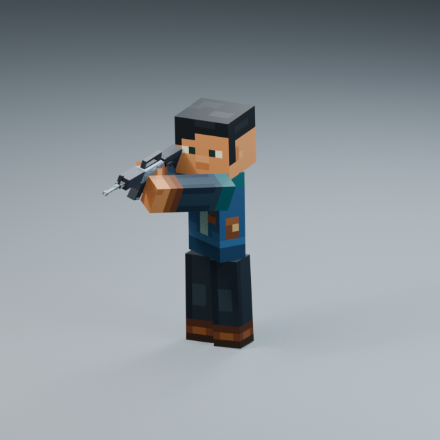

**Current Pending v001: face clearance refinement (2026-10-19).** Open [the current review](face_clearance_refinement_20261019/README.md). All earlier source files/reviews remain unchanged; the existing Showcase selects this refined source.

**Current Pending v001: user pose reference refinement (2026-10-18).** Open [the current refined review](reference_pose_refinement_20261018/README.md). The source/reviews below preserve the previous Pending pose unchanged; the existing Showcase selects the refined source.

# Rifle Aim / Hold ActionsStyle v001 — Pending Blender review

One new Action: `Rifle_Aim_Hold_ActionsStyle_v001`, with the actual Rifle Stylized V2. Open the existing `blender/animation/showcase/Animation_Showcase.blend`, then **N → Animation Library → Rifle_Aim_Hold_ActionsStyle_v001**. It is in the focused list, marked **Pending**. Use Restart / Play or Space; Front / 3/4 / Side buttons change review view. The saved file opens on the Hold pose at frame85. All previous entries and archived animations remain selectable.

The user has approved the current Rifle Ready Walk/Run gameplay. That accepted baseline is recorded in `docs/animation/baselines/rifle_ready_gameplay_accepted_v002/`: normal animation playback1×, movement1.25×, Walk2.25m/s / Run6.28875m/s. This Aim study does **not** alter Godot, the approved Ready Actions, weapon assets, camera or transitions.

## Original-speed review

- [Front, 30FPS / 1×](aim_front_30fps_1x.mp4)
- [Three-quarter, 30FPS / 1×](aim_three_quarter_30fps_1x.mp4)
- [Side, 30FPS / 1×](aim_side_30fps_1x.mp4)

| Phase | Frames at30FPS | Time |
| --- | --- | --- |
| Ready | 1–19 | 0–0.6s |
| Raise | 19–37 | 0.6–1.2s |
| Hold | 37–145 | 1.2–4.8s |
| Lower | 145–163 | 4.8–5.4s |
| Ready return | 163–217 | 5.4–7.2s |

Play1–216; frame217 is the matching closing key, excluded from playback. Hold37–145 also has a matching boundary; a future hold loop would play37–144. This is ONE Action with phases, not separate new variants. No gameplay blend implementation is implied.

Both arms remain rigid blocks, with identity forearm transforms and unit scale. The head leads the raise, the upper body follows, and controlled breathing continues through the hold. The rifle remains near the right eye; the holding set follows the approved Ready calibration on entry/exit. The planted lower-body pose is unchanged. The support side has restrained breathing life rather than uncontrolled sway.

## Reference and adaptation

The actual SHA-pinned Actions & Stuff1.12 pack was inspected directly. Crossbow base hold uses `njvelc.ltqtzr` → `rrvlnm` + `dubgwy`; charged aiming uses `knoyhk.gjhnog` → `jawwtn` + `asxvzc`. Source aim divides target-look response between waist and arms, keeps asymmetric support, and retains separate holding rhythms. See [REFERENCE.md](REFERENCE.md) for exact files, timing conventions and rig limitations.

The source has no literal long-rifle Ready→ADS→Ready animation. This candidate authors that transition and calibrates the long rifle around the verified crossbow handling principles. Right-hand contact stays exact, with a35mm contact relocation within the rigid block hand during the raise. The left support repositions along the rifle. The rifle briefly moves forward on raise/lower to clear the square head; no elbow, mesh or rest-rig changes were introduced.

## Validation and preservation

The independently reopened saved Action passed433 pose samples across the full7.2s sequence: zero forbidden geometry intersections, zero foot drift at visible precision, no elbow bending or scale deformation, grip/support anchor errors below0.001mm, exact full-loop and Hold-loop boundaries. The sight reference stays within40.7mm of the right-eye reference; actual rifle/head surface clearance is at least5.9mm. Hold shoulder-surface gap is at most6.1mm. The calibrated support palm anchor is exact; the rigid mesh's inherited contact-surface gap reaches13.6mm (approved Ready already has an11.4–13.0mm gap), rather than claiming a new flexible hand mesh.

All87 existing Showcase Actions and all existing rig, mesh, material, image, camera, light, text, collection and review-sequence data were fingerprinted before/after registration. The authoring container's20 prior Actions are also exact. See `geometry_validation.json`, `registration.json`, `reopen_validation.json`, `native_playback_validation.json` and `media_validation.json` for checks. Presentation-only render camera copies frame the long barrel; existing camera datablocks are unchanged.

The new source contains an inherited source-derived Ready pose and is **research-only / production-ineligible**. Original custom transition motion does not clear the inherited source material for commercial release. No Godot integration is authorized until this Blender result is approved.

## Reproduction and storage

`authoring/motion.py`, `build.py`, `validate.py`, `render.py` and `aim_parameters.json` preserve the final authoring recipe. Run build from the unchanged approved Ready Idle v004 source, never the canonical Showcase (which already contains this Action); the builder refuses an already Approved Aim. Run `Blender --background --disable-autoexec <Ready-v004-source.blend> --python-exit-code 1 --python <this-folder>/authoring/build.py`, then validate/render the resulting study source. Do not run these over an approved file; use a preserved copy for any later revision. Inspect the existing manifest source/action SHA values before rebuilding, and explicitly re-register a changed Pending source with updated hashes.

The compact `source_reference.json` records source identifiers, controller states and content hashes. The proprietary pack, full extraction, sampled source caches, fit diagnostics and pre-change recovery copies remain outside Git. They are not needed to play the baked Action. Source `.blend` and canonical Showcase use existing Git LFS rules; approximately12MiB +81MiB of new LFS versions were expected for this update. Videos are small ordinary Git files. No tracking migration, history rewrite, force-push or extra project/Showcase was performed.
