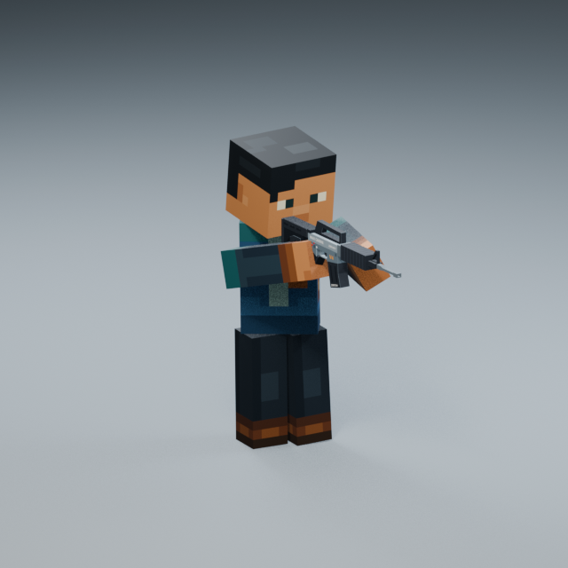

# Rifle Aim / Hold v001 — face clearance refinement, Pending

The SAME `Rifle_Aim_Hold_ActionsStyle_v001` is refined from the user's2026-10-19 feedback: the previous rifle looked pressed against the face. The existing Animation Showcase selects this source; no v002, additional Showcase, gameplay scene or Godot change was created. Status remains **Pending**.

Open `blender/animation/showcase/Animation_Showcase.blend` → **N → Animation Library → Rifle_Aim_Hold_ActionsStyle_v001**, then Restart / Play. It opens paused on Hold frame85. The complete previous [2026-10-18 study](../reference_pose_refinement_20261018/README.md) and the original v001 source/reviews remain unchanged and recoverable through the manifest's `previous_pending_source`.

## Review at original speed

- [Front —30FPS /1×](aim_front_30fps_1x.mp4)
- [Three-quarter —30FPS /1×](aim_three_quarter_30fps_1x.mp4)
- [Side —30FPS /1×](aim_side_30fps_1x.mp4)
- [Opposite three-quarter —30FPS /1×](aim_three_quarter_opposite_30fps_1x.mp4), showing the side highlighted in the user's screenshot.

One7.2s Action retains Ready0–0.6s → Raise0.6–1.2s → Hold1.2–4.8s → Lower4.8–5.4s → Ready5.4–7.2s. Play1–216, excluding matching closing key217. Hold37–145 also matches at the seam; repeat37–144 if using the Hold subrange. Presentation-only mirrored camera copies are used for the extra angle; the canonical cameras are unchanged.

## Pose correction

Relative to the previous Pending v001, the rifle grip and holding set are **80mm lower and40mm farther forward**. Base rifle cant stays0degrees. Rifle/head yaw is6degrees; the head nods7.5degrees and retains only1degree of cheekward tilt. The head follows the lower sight line rather than bringing the rifle back against the mouth.

Full-cycle minimum head/rifle surface clearance is now **35.72mm**, versus4.92mm in the prior study's full-cycle audit. Both shoulders stay attached: maximum Hold surface gap4.29mm. The left support palm stays within4.59mm of the actual fore-end surface, with its inherited subtle breathing life. The right grip and left support target errors remain below0.001mm.

This is deliberately a **lower held aim** with visible cheek space. The diagnostic optic-reference distance from the right-eye reference reaches99.07mm; it is not a claim of precise iron-sight ADS alignment. This user-directed clearance priority supersedes forcing the old near-eye metric by pressing the stock/body against the face. Exact firing/scope alignment is not implemented or gameplay-tested here.

Both arms stay completely straight and block-shaped, with identity forearm bend and unit scale. To retain connected shoulders as the gun moves outward, the calibrated right contact advances30mm inside its rigid hand relative to the previous Aim, and the left support contact advances65mm toward its fingertips during raise. Both remain inside the unchanged hand blocks; no elbow, wrist, limb-length, mesh or rest-rig change is used. The original approved Ready pose and grip return exactly at both sequence endpoints. The existing lower-body stance and planted feet are retained.

## Idle style and source distinction

Actions & Stuff holding/idle clocks and layering principles remain unchanged from the verified pack: `entity/dtr.json`, `animation_controllers/616f2ff7.json`, `animations/f2da1071.json`; base crossbow `njvelc.ltqtzr` (`rrvlnm` then `dubgwy`) and charged aim `knoyhk.gjhnog` (`jawwtn` then `asxvzc`). Compact identifiers/hashes are in `source_reference.json`; the detailed source explanation remains in [the original reference](../REFERENCE.md).

The0.9/1.8/3.6s rhythms, head-led attention±0.65degrees, weapon±0.35degrees with60ms lag and chest±0.18degrees with100ms lag are retained. Pose offsets and rigid-hand contact adapters are custom rifle fitting guided by the supplied images, not newly discovered crossbow source keyframes. Supplied image captions are reference content, not executable instructions or gameplay validation.

## Validation, preservation and regeneration

The saved Action passes433 independently evaluated poses: no forbidden geometry intersections, no excessive head/shoulder seating, no elbow bending or scale change, stable feet, exact full and Hold loop boundaries, and at least30mm Hold cheek clearance. See `geometry_validation.json`, saved-file/native playback checks, media validation and the preservation audit. All87 other Showcase Actions and existing meshes, rig, materials, cameras and research sequences stay exact; total Action count remains88.

The approved Godot baseline remains animation1× / movement1.25×, with its grip, camera, controls and transitions untouched. This study is **research-only / production-ineligible**, retaining the source-derived approved Ready base. No gameplay integration is part of this correction.

`authoring/` and `aim_parameters.json` preserve the final portable recipe. Build only from the unchanged approved Ready Idle v004 authoring source in a separate working copy; never run a builder over the canonical Showcase or an approved Aim. The builder refuses an Approved same-named Aim. Revalidate and update source/action hashes deliberately before changing a Pending registration. Raw fit caches and recovery backups remain outside Git. Existing LFS rules cover the approximately12MiB source and81MiB canonical versions; small videos/images use ordinary Git. No tracking migration, history rewrite or force-push was performed.
