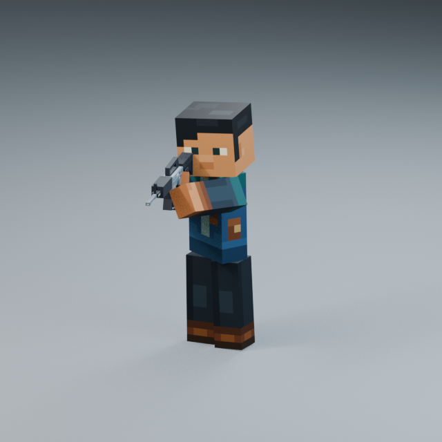

# Rifle Aim / Hold v001 — user pose reference refinement, Pending

The SAME `Rifle_Aim_Hold_ActionsStyle_v001` is refined for the user's2026-10-18 pose sheet and screenshot feedback. No additional animation variant, Showcase or Godot scene was created. Select it in the existing **Animation_Showcase.blend → N → Animation Library**, then Restart / Play. Saved Hold pose is frame85; status remains **Pending**.

## Review at original speed

- [Front — 30FPS /1×](aim_front_30fps_1x.mp4)
- [Three-quarter — 30FPS /1×](aim_three_quarter_30fps_1x.mp4)
- [Side — 30FPS /1×](aim_side_30fps_1x.mp4)

One7.2s Action, playable1–216: Ready0–0.6s → Raise0.6–1.2s → Hold1.2–4.8s → Lower4.8–5.4s → Ready5.4–7.2s. Closing key217 is excluded. Hold37–145 has a matching boundary (loop37–144). The transition and hold remain in-place with the existing Ready lower-body stance and unchanged character proportions.

## What changed versus the previous Pending v001

The user pose sheet is the main visual target: a horizontal rifle, connected shoulder/arm silhouette, right-eye alignment, and a real support role at the fore-end. The approved character and Rifle Stylized V2 keep their own appearance.

| Item | Previous v001 | Refined same v001 |
| --- | --- | --- |
| Base rifle cant |20degrees |0degrees; barrel stays level |
| Head and rifle direction | Head neutral, rifle neutral, heavily canted holding set | Rifle yaw12.11degrees, head7.79degrees with4.03degree cheekward tilt |
| Maximum Hold shoulder surface gap |6.10mm |4.65mm |
| Maximum left-hand/rifle surface gap |13.60mm |5.37mm; support at fore-end |
| Near-eye sight reference offset |40.69mm |38.29mm maximum |
| Head/rifle minimum surface clearance |5.93mm |4.92mm across the full sequence |

The right-hand grip is calibrated inside the existing rigid block hand; both hands remain constrained to their respective holding targets. Moving that contact toward the fingertips during raise is an explicit rifle/rig adaptation. Neither elbow bends; no bone scale, limb length, mesh, material or rest-rig change was used to achieve the silhouette. A small4mm outward support adjustment clears a fore-end corner without visibly detaching the palm.

The rifle is close to the cheek/shoulder line while maintaining measured head clearance. This is not a guarantee that its short rigid stock is flush with an anatomical shoulder pocket from every angle. Straight full-length block arms and the unchanged rifle geometry limit exact equivalence to the illustrative reference.

## Actions & Stuff Idle influence

The directly verified pack graph remains `entity/dtr.json` → `animation_controllers/616f2ff7.json` → `animations/f2da1071.json`. Base hold is `njvelc.ltqtzr`: `rrvlnm` then `dubgwy`; charged aim is `knoyhk.gjhnog`: `jawwtn` then `asxvzc`. Already-charged logic selects the endpoint rather than replaying charge. See [the source audit](source_reference.json) and [the original detailed reference](../REFERENCE.md).

The pose is authored from the user image; the source supplies handling principles and separate0.9/1.8/3.6s holding clocks. Subtle breathing continues under a3.6s attention rhythm: head yaw±0.65degrees leads rifle yaw±0.35degrees by60ms; chest yaw±0.18degrees follows with100ms delay. These bounded amplitude/lag choices are custom authoring, not literal proprietary Aim keyframes. The head stays on the general sight line while the support side breathes slightly. No firing/reload clip or generic large look-around was substituted.

## Validation and preservation

Saved Action independently sampled at433 poses: no forbidden head/arm/rifle/magazine intersections, forearm bend0, unit scale, stable feet, grip/support anchor error below0.001mm, and exact full-loop/Hold boundaries. `geometry_validation.json` contains the measurements. The source container's20 old Actions are exact.

The canonical library retains88 Actions total. Only this Pending Action is replaced. All87 other Actions and all existing rig, mesh, material, image, camera, light, text, collection and research-sequence data are fingerprint-checked. The manifest's `previous_pending_source` points to the complete unchanged previous v001 source; previous videos, reference notes, source .blend and current native-session backup are preserved. No approved animation data is overwritten.

Gameplay remains the accepted animation1× / movement1.25× baseline; no Godot edits or integration are part of this refinement. Any unrelated concurrent Zombie lab edits are recorded separately by the preservation audit and are not reverted. This candidate is **research-only / production-ineligible**, retaining the inherited source-derived Ready base.

## Files and reproduction

`references/user_aim_pose_reference.png` and `references/previous_v001_user_screenshot.png` preserve the supplied images as reference data. Their embedded captions are not technical validation or project instructions.

`authoring/motion.py`, `build.py`, `validate.py`, `render.py` plus `aim_parameters.json` preserve the final recipe. Build from the unchanged approved Ready Idle v004 source in an isolated authoring copy; do not run a builder over the canonical Showcase or an approved Aim. The builder refuses an Approved same-named Aim. Source/action hashes must be updated deliberately if a Pending study is rebuilt. Raw fit searches and backups remain outside Git. Existing LFS tracking covers .blend files; this revision adds roughly12MiB source plus an81MiB canonical version, without a tracking migration or history rewrite. Small review videos remain ordinary Git files.
