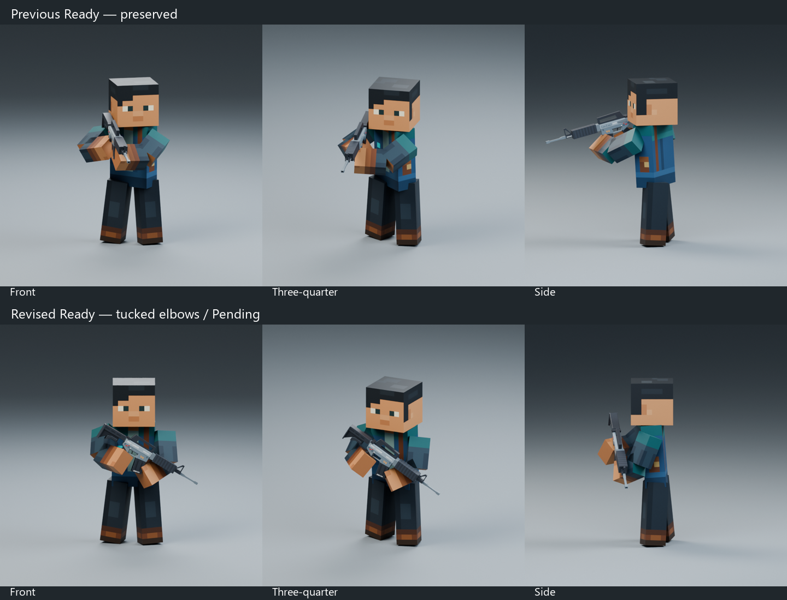

# Rifle Ready — higher diagonal hold, Pending

Open the existing [Animation Showcase](../../../showcase/Animation_Showcase.blend), then **N → Animation Library → Rifle_Ready_V2_v3_Test**. The actual Rifle Stylized V2 is attached and synchronized. Front / 3/4 / Side, Play, Pause, Restart and Loop remain available. Reopen the exact file if an older window still shows an earlier list; preserve personal unsaved edits separately first.

This Ready-only refinement follows the latest voxel-soldier reference. The user explicitly accepted elbow bending and requested less visible elbow cuts. The rifle is higher across the front of the chest, angled down approximately 32°, with tucked, controlled elbows. The head remains calm and clear. Both hands meet the trigger-grip/front-support targets, and the feet retain the approved idle-derived planted base.

The existing connected elbow joints retain their original lengths and attachment points. Controlled bends, tucked placement and arm orientation reduce exposed end-cap wedges. Unit-scale bones, meshes/materials and the rest rig remain unchanged. The segmented rectangular construction can still be noticeable at close or unusual angles; these are not seamless sleeve joints. No sleeve geometry, fingers or new rig controls were invented.

The prior `Rifle_Ready_V2_Test` and straight-arm comparison `Rifle_Ready_V2_v2_Test` remain independently selectable and unchanged. Aim and Back Holster were not refined. All three Ready versions are Pending; none has been automatically approved.

## Review

| Version | Front | Three-quarter | Side |
| --- | --- | --- | --- |
| Previous Ready | [Front](previous_front.png) | [3/4](previous_three_quarter.png) | [Side](previous_side.png) |
| Straight-arm comparison | [Front](straight_front.png) | [3/4](straight_three_quarter.png) | [Side](straight_side.png) |
| Latest tucked-elbow Ready | [Front](revised_front.png) | [3/4](revised_three_quarter.png) | [Side](revised_side.png) |

All comparisons use the same central cameras, lighting transforms and original rifle scale/proportions. Lights were enabled for rendering without saving changes to their central settings. The diagonal presentation now reads as a practical front-body ready hold rather than the previous near-aim silhouette. The forearms support the weapon without the earlier large exposed inner-elbow wedges.

F1 surface diagnostics find no rifle/head, rifle/chest, rifle/upper-arm, arm/head or opposite-arm crossings. Forearm contacts (55 left / 16 right polygon pairs) are at the intentional block-hand grip/support regions. Counts are not penetration depths; finger-level precision and all-angle elbow seamlessness are not claimed. This is a static Ready/breathing study, not moving weapon-layer or gameplay validation.

## Timing and verification

Independent Action, F1–120 at 30 FPS, closing F121 excluded: four seconds of restrained breathing. The existing WeaponCarrier and Action slot are preserved. [Fresh reopen/switch/contact/rig checks](validation.json), [loop pose/velocity evidence](loop_quality.json), [real GUI playback](gui_playback.json), [F1 intersection diagnostics](intersection_diagnostics.json), and [protected-file hashes](preservation.json) document validation. Original study: [rifle_ready_v3_review.blend](rifle_ready_v3_review.blend).

Backups: `.validation/rifle_ready_v3/before/`, with the earlier straight-arm study also backed under `.validation/rifle_ready_v2/before/`. All prior Actions, chosen rifle source, Weapon Showcase and Godot files are preserved. Stop for Blender review before Aim, Back Holster or gameplay integration.
