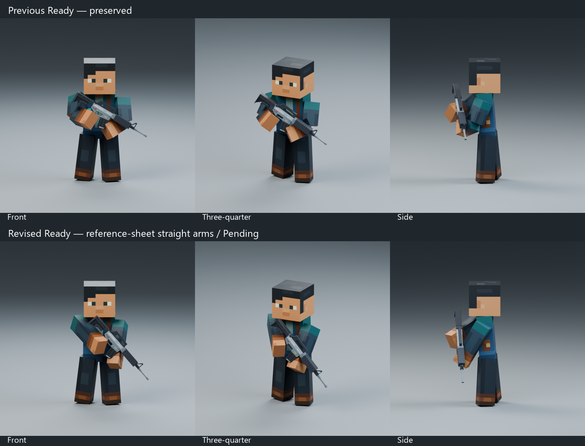

# Rifle Ready reference-sheet pose — Pending

Select **Rifle_Ready_V2_v4_Test** in **N → Animation Library** in the SAME [Animation Showcase](../../../showcase/Animation_Showcase.blend). Reopen the exact file in a fresh Blender window if an older list is still displayed; preserve any personal unsaved edits separately first.

The latest user-supplied reference sheet supersedes the previous elbow-bend direction for this comparison. Both complete arms are straight, with no elbow articulation, and the rifle points diagonally down approximately 50° across the torso. The right arm reaches inward/forward to the trigger grip; the left is more upright and supports the handguard. The face stays calm and readable, and the approved idle-derived legs remain planted. Reference artwork guides the pose; its text is not treated as a technical measurement or proof of compatibility.

The original rifle remains at scale1.0 with unchanged geometry, texture and materials. Existing arm lengths and connected joints are unchanged. Pose-only shoulder clearance is100mm downward and15mm right-side outward; no rig/rest/mesh rebuild or arm scaling. Straight forearms remove the bent-joint wedges; close-up rectangular sleeve/hand seams still exist.

| Review | Front | Three-quarter | Side |
| --- | --- | --- | --- |
| Previous bent-elbow Ready v3 | [Front](previous_front.png) | [3/4](previous_three_quarter.png) | [Side](previous_side.png) |
| Latest straight-arm Ready v4 | [Front](revised_front.png) | [3/4](revised_three_quarter.png) | [Side](revised_side.png) |

This is a four-second restrained breathing hold, F1–120 at30FPS, closing121 excluded. Arm and actual rifle transforms share one independent Action/WeaponCarrier slot. There is no root travel or Godot edit. Previous Ready, v2 straight-arm, v3 elbow version, Aim and Back Holster remain unchanged and selectable. v4 remains Pending; the reference request is not approval of the result.

F1 surface diagnostics check head/chest/upper-arm clearance and intended block-hand grip contacts. The simplified hands do not establish finger-level trigger placement. No moving weapon layers, aiming calibration, draw/stow or gameplay certification is claimed. The narrower character and unchanged rifle proportions prevent a pixel-exact reproduction of the reference soldier.

[Reopen/switch/slot/hand/feet/rig validation](validation.json), [loop velocity evidence](loop_quality.json), [GUI playback](gui_playback.json), [F1 contact diagnostics](intersection_diagnostics.json), [protected-file hashes](preservation.json), [authoring study](rifle_ready_v4_review.blend). Backups: `.validation/rifle_ready_v4/before/` and `before_clearance_fix/`. All old Actions are retained when saving with another clip selected. Stop for Ready review before Aim, Back Holster or Godot integration.
