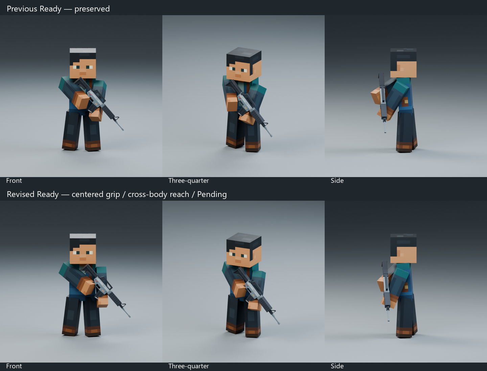

# Rifle Ready centered grip and cross-body reach — Pending

Select **Rifle_Ready_V2_v5_Test** in **N → Animation Library** in the SAME [Animation Showcase](../../../showcase/Animation_Showcase.blend). Reopen the exact file if an older Blender window still shows a previous list; preserve personal unsaved edits separately first.

The latest user correction places the rifle grip inside the middle of the right block hand, then moves the complete straight right arm and attached rifle toward the character's left/support-hand side. The right palm now targets weapon-local `(0,0,-0.07)` instead of the prior outside-face offset `(0.055,0.015,-0.07)`. The right hand reaches approximately9cm farther across toward character-left than v4, and the rifle follows as one synchronized pose. The left arm remains straight and supports the handguard with a more vertical silhouette. The muzzle-down angle stays approximately50°.

Both elbows remain unbent throughout the restrained four-second breathing loop. Existing arm lengths, connected joints,100mm shoulder lowering/15mm right shoulder clearance, planted legs and calm head are preserved. No mesh deformation, scale/stretch, new rig controls or rifle geometry/material changes. The original weapon stays scale1.0. The grip is represented by solid block-hand overlap; there are no fingers or simulated trigger squeeze.

| Matching review | Front | Three-quarter | Side |
| --- | --- | --- | --- |
| Previous Ready v4 | [Front](previous_front.png) | [3/4](previous_three_quarter.png) | [Side](previous_side.png) |
| Centered grip / cross-body Ready v5 | [Front](revised_front.png) | [3/4](revised_three_quarter.png) | [Side](revised_side.png) |

F1 surface diagnostics show no rifle/head/chest/upper-arm, arm/head or opposite-arm crossings. Forearm contacts (67 left /45 right polygon pairs) represent intended handguard/grip grasping, including the deeper centered right-hand hold. Counts are not penetration depths. Close-up sleeve/hand seams and simplified hand geometry remain limitations; moving weapon layers, aiming, draw/stow and gameplay are unvalidated.

Independent Pending Action, F1–120/30FPS, closing121 excluded. Actual Rifle Stylized V2 follows the existing WeaponCarrier in the same Action. Prior Ready/v2/v3/v4, Aim and Back Holster remain unchanged and selectable. No Godot changes or automatic approval.

[Reopen/switch/slot/contact/feet checks](validation.json), [loop velocity](loop_quality.json), [actual GUI playback](gui_playback.json), [F1 intersections](intersection_diagnostics.json), [inactive Action retention](inactive_action_retention.json), [protected-file hashes](preservation.json), [authoring study](rifle_ready_v5_review.blend). Backup: `.validation/rifle_ready_v5/before/`. Stop for Ready review before Aim, Back Holster or Godot.
