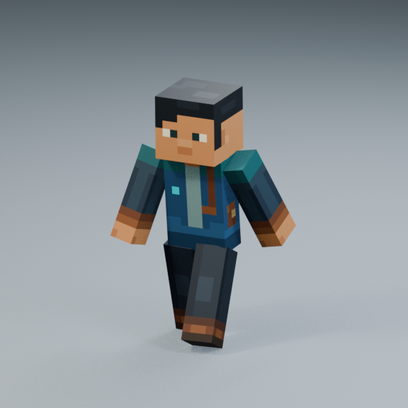

# Walk Snappy v1 — research-informed flow refinement

2026-10-13 · **Pending artistic review.** Same independent `Walk_Snappy_Test_v1` entry in the existing central Animation Showcase; 20 entries total. Running remains research-only. Rifle Ready Idle remains paused and preserved.

## Review in Blender

Open [the existing Animation Showcase](../../../../showcase/Animation_Showcase.blend), hover over its 3D viewport, press **N**, and choose **Animation Library → Walk_Snappy_Test_v1**. Use Front / 3/4 / Side, Play and Restart. The saved file selects the refined Walk. If an older copy is already open, reopen the saved file so it loads the updated Action; Refresh Library alone does not replace a cached Action. Preserve any unrelated unsaved work before reopening.

[Authoring source](walk_snappy_review.blend) is a separate study file, not another Animation Showcase. The [first Snappy source and review](../README.md) remain unchanged for comparison. The approved Walk and all older Run Actions remain unchanged.

## Original-speed media

All videos are six seconds at 30 FPS, rendered at their native Action timing without playback acceleration.

- [Front](snappy_front_1x.mp4) · [Three-quarter](snappy_three_quarter_1x.mp4) · [Side](snappy_side_1x.mp4)
- [All three views](walk_snappy_three_views_1x.mp4)
- [Approved Walk vs refined Snappy Walk](approved_vs_snappy_1x.mp4): each uses its original cadence, 1.2 seconds and 1 second respectively.
- [First Snappy vs refined Snappy](first_snappy_vs_refined_1x.mp4): matched one-second cycles isolate the receiving-flow change.
- Stills: [Front](snappy_front.png) · [Three-quarter](snappy_three_quarter.png) · [Side](snappy_side.png)

## Evaluation and comparison

The [expanded Actions & Stuff study](../../../../../../docs/animation/ACTIONS_AND_STUFF_LOCOMOTION_STUDY.md) combines official movement documentation, annotated supplied-video phases, recording limits and practical original design recommendations. It distinguishes documented behavior, visible observations, measurements, hypotheses and proposals. No proprietary animation assets or keyframe data were extracted.

The first Snappy experiment already has concise passing/recovery, close leg tracks, asymmetric support, restrained independent arms and a quick soft receiving dip. Its pelvis height curve also stopped at every intermediate key, including a mid-rise transit pose. This refinement keeps the same height extrema but carries velocity through that transit and downward through receiving contact. The body now flows into the short compression rather than pausing before it. The contact-driven leg placements were rebaked to maintain ground reach.

| Property | First Snappy | Current refinement |
|---|---|---|
| Cadence | 1 second | Unchanged |
| Frames | 1–30 at 30 FPS; closing 31 excluded | Unchanged |
| Hip height range | 35 mm | Unchanged |
| Vertical speed at contact | Approximately zero | −0.12 m/s |
| Vertical speed at mid-rise | Approximately zero | +0.13 m/s |
| Height extrema | Zero vertical speed | Retained |
| Tracks / lateral hip range | 0.27 m / 30 mm | Unchanged |
| Foot-target timing, arm/torso/head design | Original Snappy design | Retained |

Weight transfer remains support-driven, with 64% LEFT / 66% RIGHT support and 30% total double support, without flight. These are our design values, not Oreville measurements. Fore-aft hip travel is 40 mm. The brief receiving load and longer recovery preserve the soft “nhúng nhúng” feeling, while straight full arms use unequal amplitudes and delays. Head response stays restrained. The change is subtle in isolated stills; use the matched before/after video to judge flow.

LEFT receiving is F1 / phase 0; RIGHT is F16 / phase 0.5. Forward remains −Y, with no object/root travel or scale animation. At the nominal virtual travel of 1.02 m/s, one full cycle represents 1.02 m. That speed is a contact-validation convention, not a Godot controller change.

## Verification and limits

- [Motion validation](motion_validation.json): 961 subframe samples; no unwanted nonadjacent overlaps or unsupported samples, unchanged rest rig, straight arms, rigid lengths and static root. Maximum rigid-length error is 0.000275 mm; minimum floor clearance is 0.398 mm.
- At nominal virtual travel, maximum supporting-edge drift is 0.00191 mm and height error is 0.00181 mm. The rigid sole rocks around its active edge; this does **not** establish flat full-sole contact or eliminate sliding under arbitrary runtime speed, terrain or blending.
- Loop pose error is zero; channel boundary tangent difference is 0.00000128. Finite vertex-velocity difference across the seam is 0.00218 m/s using a 0.01-frame comparison interval. Periodic tracks pass the existing continuity checks without relaxed tolerances.
- Pose-only leg translation reaches 107.93 mm to accommodate rigid-leg ground reach. No rig, mesh proportions or rest transforms were changed. Future runtime/export treatment of these pose translations needs explicit review.
- [Showcase validation](showcase_validation.json): 110 checks pass, including all 20 entries, slots, frame ranges, source hashes, three views, switching and inactive save/reopen retention. All 19 other Action signatures and manifest entries remain exact.
- [GUI playback](gui_playback.json): actual Blender play, loop wrap, pause and restart pass; approved Ready remains Approved and Snappy remains Pending.
- [Appearance validation](appearance_validation.json): character/rifle geometry, UVs, weights, material and image resources unchanged.
- [Media validation](media_validation.json): all seven original-speed videos decode fully, 180 frames each. Rendered phase sheets were visually inspected for framing, silhouette, contact and loop presentation.
- [Preservation audit](preservation.json) records protected-file hashes and scoped changes.

Future Godot integration should align receiving/support phases and preserve pose velocity during starts, stops and speed changes. The approved Idle has a different stance width; a generic crossfade cannot certify foot stability. Sharp turns, reversals, weapon layers, mobile performance and variable travel speeds are not validated by this Blender study. Production gameplay and the existing Godot lab remain unchanged.

## Preservation

Pre-edit central files are backed up in `.validation/actions_stuff_study_v1/before/`. The original first Snappy files remain in the parent review directory, byte-identical. Only the current Pending Snappy Action is replaced in the central library; all other Actions remain unchanged.

Current source SHA256: `b61cab7c0bbf535fc70d2672958b78c9c2470ce96505ce34909ff72d90cc3c8c`.

Current Action SHA256: `79a195a0d42adc21afc02025782a9d4fef9686d970ed174b267dcc3ffb52f031`.

First Snappy source SHA256: `abba4fc3181adc1150d83ddeab9e4a6a2c0579167f6b5a7537cb365352825d82`; Action: `aa82e5183b2db8e3103b03036a4857f3f97c9421d1a907d1c465563b06fab084`.

No Run Snappy Action, Godot integration, production replacement, approved Action edit or rifle refinement was performed. Stop here for Walking review.
