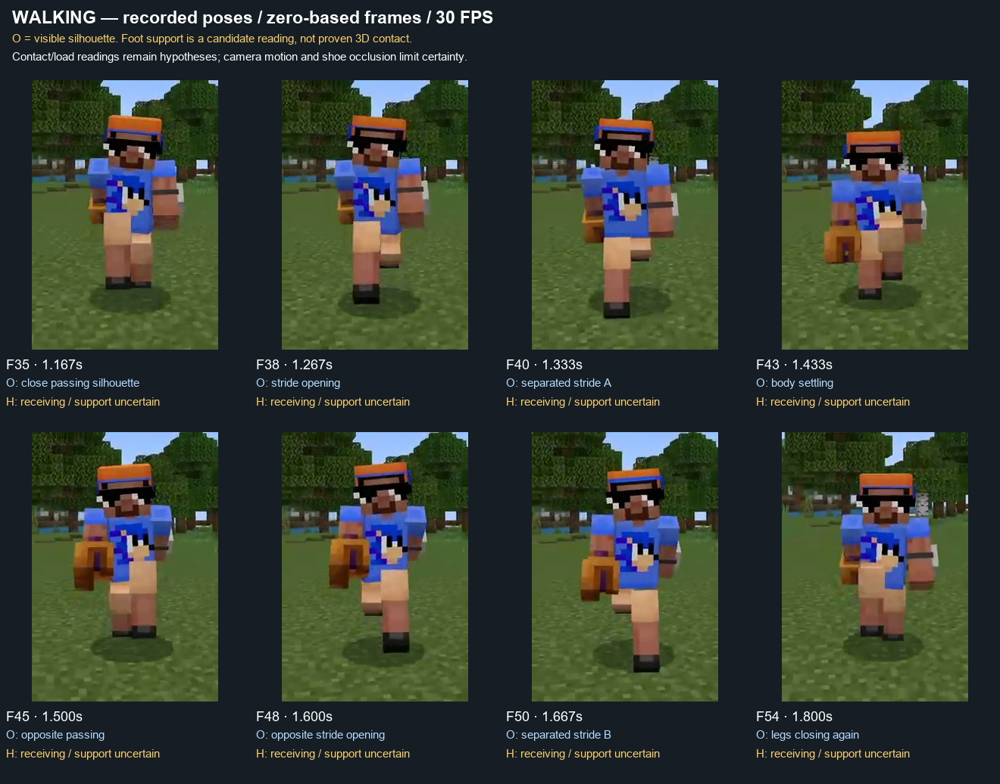
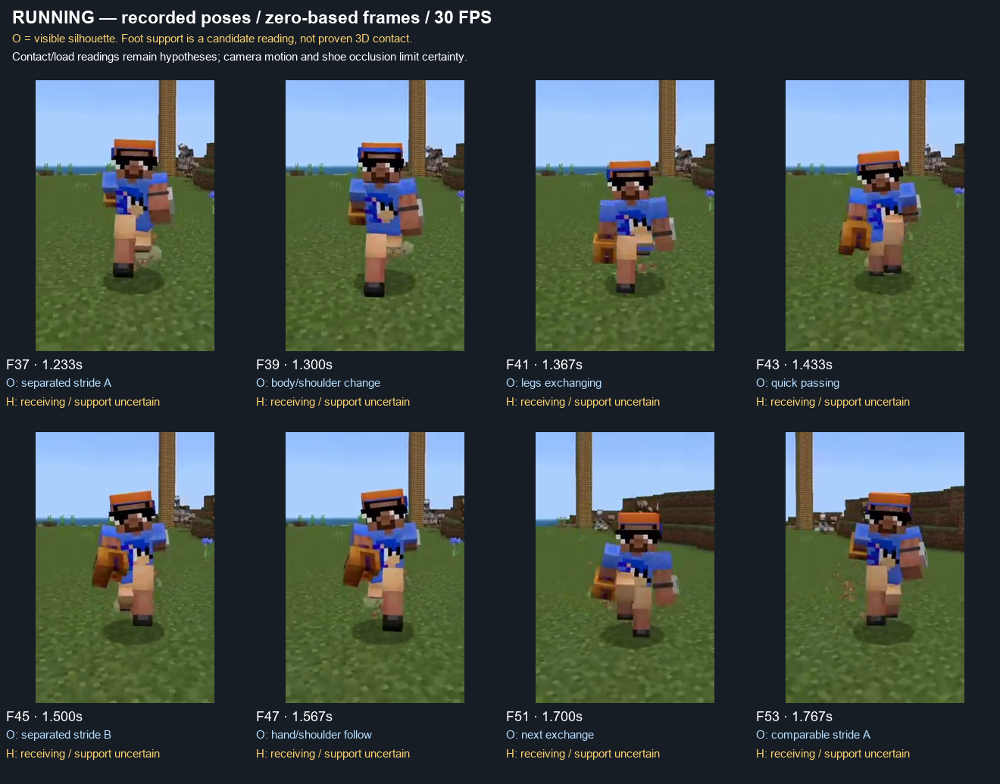

# Actions & Stuff locomotion study

2026-10-13 · Focus: snappy, fluid walking/running for our original Expressive Blocky character. **Research and Pending Blender experiment; no production or Godot integration approval.** Rifle Ready Idle remains paused and preserved. `Walk_Snappy_Test_v1` already exists in the central Showcase; this research informs its next refinement. Do not create `Run_Snappy_Test_v1` before explicit Walk approval.

## 1. Evidence and access

**D** = official documented behavior. **O** = visible pixels. **M** = measured file/our own animation data. **H** = interpretation that the footage cannot prove. **P** = original implementation proposal. **U** = unknown. A timing measurement in a recording is not a measurement of the original animation curves.

| Reference | Actual access and inspected scope | Appropriate use |
|---|---|---|
| [Oreville Animation Overview](https://guides.orevillestudios.com/Animations-23fd70150598811aa3a8d653e02b1322) | Official text read. | Player animation scope and presentation priorities. |
| [Oreville 1.10 / Player Movement](https://guides.orevillestudios.com/1-10-341d7015059880c68287ce0877d3a123) | Official movement/rotation/transition passages read; unrelated changelog content excluded. | Explicit behavior goals, not a technical implementation specification. |
| [Official Content Guide](https://guides.orevillestudios.com/Actions-Stuff-Content-Guide-23fd70150598804aab49f4d6f3f9974a) | Official overview/index read; links the supplied trailer. | Product context and trailer provenance. |
| [Official trailer](https://www.youtube.com/watch?v=VDk8niB2Obw) | Web text fetch failed; actual muted browser video playback and paused images worked. Duration shown90.021s. Sampled5.385,15.385,25.385,35.385,45.385s, then35.552/35.719/35.885/36.052s with frame stepping, and46.052/56.052/66.052/76.052/86.052s. **Selective shots, not full-trailer frame-by-frame analysis.** | Item-aware upper-body silhouettes and staging. Edited shots cannot establish a complete gait or transition algorithm. |
| `C:/Users/ADMIN/Desktop/walking.mp4` | All304 frames freshly decoded at30FPS:10.133s,246×356. All-frame sheets inspected in the preceding Walk study and rechecked against enlarged phase sheets here. | Primary supplied Walk timing/silhouette evidence. Pack version is unknown. |
| `C:/Users/ADMIN/Desktop/Running.mp4` | All349 frames freshly decoded at30FPS:11.633s,250×380. Same inspection method. | Primary supplied Run timing/silhouette evidence. Pack version is unknown. |

Local source hashes, frame differences, annotation indices and access measurements: [decode report](references/actions_and_stuff_locomotion_2026-10-13/decode_report.json). Walk SHA256 `2b4930b899230814606fc3f6ce341e6966b82a91d6a5d4a665e3057938beab0c`; Run `3db973b8dccf5e37d94cb6ed5a7e61fe6f45386c50d438112d058c5c23af55a2`.

**D — official scope:** Oreville describes smooth first-/third-person player movement, directional walking, running and other actions, alongside footsteps synchronized to animation. This makes visual and audible receiving events relevant to step readability; this study does not claim an audio analysis of the supplied clips. [Animation Overview](https://guides.orevillestudios.com/Animations-23fd70150598811aa3a8d653e02b1322)

**D — movement behavior:** 1.10 describes smoother movement, improved backward and sideways movement, combat strafing, planted-foot jump launch, landing-to-run continuity without resetting the leg, more fluid rotation, and less complete head/body rotation coupling. It also describes movement interrupting a stationary heavy landing. These are strong transition goals; the page supplies no numerical support percentages, curve handles, skeleton, IK solver, gait-phase variable or blend durations. [1.10 Player Movement and landing sections](https://guides.orevillestudios.com/1-10-341d7015059880c68287ce0877d3a123)

**D — visual philosophy:** the overview presents smoother animation within Minecraft's familiar visual identity. **P:** for us, retain our own proportions, rigid limbs and soft receiving style while adopting clearer timing contrast. This is an interpretation, not an Oreville-authored animation rulebook. [Content Guide](https://guides.orevillestudios.com/Actions-Stuff-Content-Guide-23fd70150598804aab49f4d6f3f9974a)

**O — official video:** at15.385s a player and villagers form a village shot; at35.385–36.052s an armored character moves through a doorway carrying a raised torch, while the other arm and torso change independently. The feet leave the crop and the camera changes, so this sequence supports item-aware posing, not a contact-duration measurement. Other sampled shots include mobs, minecarts, swimming and scenery; they are not additional run-cycle evidence. The trailer is not established as a1.10 demonstration, and the supplied clips are not version-matched to it.

## 2. Recording limits and phase annotations

All local frame numbers below are **zero-based**, with time = frame/30. Our Blender frames are one-based. There are7 exact repeated adjacent image pairs in Walk and4 in Run;30 and43 pairs respectively have mean absolute RGB difference below1. These are whole-image recording statistics, not a count of animation holds. Do not copy the recording's duplicated frames into our Action.

Playback overlays obscure early images. Walk changes to back view atF136, shows black atF285 and then a static front shot. Run changes to back view atF141 and another front setup atF292. Camera translation/height, foreshortening, item occlusion, shadows and terrain prevent dependable3D speed, sole contact or compression measurements. No precise foot-lock or flight percentage is inferred.

Captions identify visible silhouettes; support/receiving interpretations are explicitly **H**. Complete numbered frame sheets: [Walk0–79](references/actions_and_stuff_locomotion_2026-10-13/walking_all_frames_00.jpg), [80–159](references/actions_and_stuff_locomotion_2026-10-13/walking_all_frames_01.jpg), [160–239](references/actions_and_stuff_locomotion_2026-10-13/walking_all_frames_02.jpg), [240–303](references/actions_and_stuff_locomotion_2026-10-13/walking_all_frames_03.jpg); [Run0–79](references/actions_and_stuff_locomotion_2026-10-13/running_all_frames_00.jpg), [80–159](references/actions_and_stuff_locomotion_2026-10-13/running_all_frames_01.jpg), [160–239](references/actions_and_stuff_locomotion_2026-10-13/running_all_frames_02.jpg), [240–319](references/actions_and_stuff_locomotion_2026-10-13/running_all_frames_03.jpg), [320–348](references/actions_and_stuff_locomotion_2026-10-13/running_all_frames_04.jpg).

## 3. Walk breakdown

| Recorded phase | O — what is visible | H / U — what remains uncertain | P — practical adaptation |
|---|---|---|---|
| Close pass, F35–37 /1.167–1.233s | Legs overlap more closely; the stride silhouette becomes narrow. | Exact release frame and whether the rear shoe is airborne. | Make passing concise; retain close lateral tracks rather than flaring legs apart. |
| Opening, F38–40 /1.267–1.333s | One leg rapidly becomes long/readable while the other foreshortens; hand and shoulder silhouettes change. | Pixel spacing mixes rotation, perspective and camera movement. | Accelerate recovery through the indistinct middle, then reduce speed approaching placement. |
| Receiving candidate, F41–43 /1.367–1.433s | Separated legs remain readable; the torso/head presentation settles lower in the image. | Camera motion contributes to the apparent height change; contact is not proven. | On our rig, explicitly ground the receiving edge and lower the body briefly after contact. |
| Opposite pass, F45–47 /1.500–1.567s | The leg relationship exchanges; arm/item silhouettes are unequal. | Original shoulder delay, arm mask and handedness implementation. | Keep separate arm amplitudes/phases and a quiet torso response. |
| Opposite stride, F48–52 /1.600–1.733s | The other leg dominates the stride silhouette; chest/head slope differs from the first half. | No reliable millimetre bounce or yaw estimate. | Transfer over the opposite support; retain small asymmetry without random oscillation. |
| Next pass, F55–57 /1.833–1.900s | A similar close-passing relationship returns. | Does not prove an identical loop duration across speed/settings. | Use periodic pose **and velocity**, not a duplicate last rendered frame. |

**M/O:** comparable passing configurations aroundF35 andF55 are roughly20 recorded frames/0.667s apart in this shot. Landmark uncertainty is at least1–2frames; this is a visual estimate, not an autocorrelation-derived or original-curve measurement. Our1s Walk intentionally adapts the timing to our taller rigid-leg character rather than replicating that cadence.

The attractive contrast is between a clear stride configuration and a much shorter exchange. The reference does not visibly linger in a motionless neutral pose between every step. A rigid leg remains alive through rotation, foreshortening, silhouette separation and its relation to the torso. Apparent limb shortening does not establish knee articulation or stretch.

## 4. Run breakdown — research only

| Recorded phase | O — what is visible | P — future Run design |
|---|---|---|
| Stride A aroundF37 /1.233s | Clear unequal leg reach, one dominant leg silhouette. | Stronger forward/back separation and more forward body intent than Walk. |
| Exchange aroundF40–43 /1.333–1.433s | The previous silhouette changes quickly; body and shoulders respond during exchange. | Shorter support/recovery; quick rear-leg recovery followed by a controlled receiving arrival. |
| Stride B aroundF45 /1.500s | Opposite leg dominates; hands/chest are not a perfectly mirrored static unit. | Preserve independent shoulder/arm response with larger sagittal swings. |
| Return aroundF51–53 /1.700–1.767s | Another exchange and comparable stride A. | Rejoin the same continuous gait phase without a pose reset. |
| Later front segmentF292–348 | More open arm silhouettes and energetic body rhythm in a different shot. | Use as an amplitude/silhouette reference only; do not combine its timing blindly with the earlier camera setup. |

Comparable same-side configurations aroundF37 andF53 suggest approximately16frames/0.533s in this shot, with1–2frame landmark uncertainty. Exact support duration, flight and heel/toe events remain **U**. We should design and validate those explicitly on our rig instead of treating the shadow/dust or a foreshortened shoe as proof.

Walk should retain a calmer body, longer support and no flight in this experiment. Run should earn its energy through stronger push/recovery impulses and bigger sagittal poses, potentially brief flight if it improves our silhouette and contacts. Increase controlled vertical response before lateral wobble. A faster copy of Walk would preserve Walk's support logic and fail to become a convincing Run. No numerical Run prescription below is an official Oreville value.

## 5. Mechanics that make snappy motion fluid

1. **Pose spacing varies within the step.** Cover more angle/distance during recovery's middle; narrow the spacing on arrival. This creates urgency without a discontinuity. Avoid constant angular velocity everywhere, hard holds, or a jump from the last passing frame into contact.
2. **Receiving and release have different durations.** A quick, small load followed by a longer release creates our “nhúng nhúng” weight. Compression belongs to the receiving event; it should not be an unrelated sine wave layered onto the character.
3. **Support has a meaningful job.** The stance edge moves backward in-place at nominal travel speed. The receiving foot takes over before the other foot releases in Walk. Rotating an entire character around a locked foot during a reversal still requires a bounded pivot/replant; blend duration alone cannot fix it.
4. **Secondary motion has hierarchy.** Legs/hips express the impulse; torso partly counters them; shoulders continue their arc; head facing stays readable. Small phase differences avoid simultaneous reversal of every block. Precise delays in Oreville's clips are unknown; choose our own values.
5. **Do not stop on every intermediate key.** Zero velocity makes sense at a genuine height/swing extremum. It creates a false pause at a mid-rise transit pose. Preserve through-velocity at those passages and across the loop boundary.
6. **Satisfying footfalls have a clear event.** Officially synchronized footstep audio reinforces receiving timing, but visual contact should still read with audio muted. Future audio/effects should follow verified contacts rather than an independent timer. No sound or particle changes are part of this task.

Interpolation hypotheses remain **H**: eased curves, procedural warping, constraints or layered animation could produce similar pixels. We have not established the original DCC, rig hierarchy, interpolation type, IK, locomotion code or blending system. Our own smooth curves are **P**, not reverse-engineered Oreville data.

## 6. Practical Blender design on our existing rig

Preserve the13-bone rest rig, skin weights, textures, proportions and rigid full legs/straight full arms. Use only pose transforms, keep scale1, object/root identity, forward−Y and no root travel. Keep the latest approved Walk's0.27m tracks and its support/personality language. Source references: approved `Idle_Expressive_Test_v3`, current `Walk_Expressive_Test`, preferred `Run_Expressive_v3_Test`, Expressive Arm Motion and Lower Body Recovery, alongside [Style Guide](ANIMATION_STYLE_GUIDE.md), [Expansion Guide](ANIMATION_EXPANSION_GUIDE.md) and [Workflow](ANIMATION_WORKFLOW.md).

Current `Walk_Snappy_Test_v1` is a1s/30-frame loop, with closingF31 excluded. LEFT receivingF1/phase0, RIGHTF16/phase0.5;64%/66% support,30% total double support, no flight. These are **our original design choices**, not measurements of the pack. Nominal travel1.02m/s means1.02m per cycle. Keep existing quick recovery, restrained unequal22°/25° arms,30mm lateral/40mm fore-aft/35mm vertical hip ranges and quiet head. Dense baking is an authoring convenience, not a proposed runtime requirement.

| Our phase | Frame (one-based) | Original motion objective |
|---|---:|---|
| LEFT receive / RIGHT outgoing support |1 | Arrive with continuous body velocity; contact edge grounded. |
| LEFT load minimum |3.1 | Quick26mm drop from contact height; true vertical extremum. |
| LEFT support / RIGHT recovery |~6–12 | Recover swiftly through passing; rise continuously through the mid-height transit nearF8.2. |
| RIGHT receive |16 | Exchange support without resetting hips/arms. |
| RIGHT load minimum |18.1 | Repeat soft receiving intent, retaining unequal duty/arm response. |
| RIGHT support / LEFT recovery |~21–27 | Opposite recovery and torso/shoulder follow. |
| Closing |31, excluded from rendered loop | ExactF1 pose with matching boundary tangent; body remains moving through the receiving passage. |

**Focused refinement after this study:** preserve the first Snappy source/reviews; keep the same Pending Action name and20-entry Showcase. Change only the pelvis height timing design and the contact-driven leg placements required to maintain ground reach. Replace the old zero-velocity mid-rise with continuous through-velocity, and carry downward velocity across receiving/loop contact. Retain the same height extrema, cadence, tracks, foot-target timing and arm/torso/head design. This is a flow refinement rather than another speed increase. Revalidate the whole evaluated character because changing hips affects the hierarchy.

## 7. Godot transition design priorities — future, not implemented

| Situation | Original practical recommendation | Evidence/limits |
|---|---|---|
| Idle→Walk | Respond immediately; select a receiving/support side compatible with the current stance. Replant the free foot into close walking tracks. Preserve any useful current upper-body velocity. | Our wider Idle stance cannot become the moving stance through a generic crossfade with both feet locked. |
| Walk→Idle / deceleration | Keep a valid stance anchor, shorten the remaining swing to a safe stop placement, settle into rest after support is established. Do not reverse an already released foot into its old anchor. | Source videos do not establish exact start/stop logic. This is a proposal. |
| Acceleration / Walk↔Run | Preserve LEFT=0/RIGHT=.5 receiving phases, align supporting foot and compatible pose/velocity; adapt distance-driven cadence and transition before support disappears. | Official continuity goals support this priority; our algorithms and parameters need actual gameplay tests. |
|45°/90° turns | Let input/capsule respond; use bounded visual facing, modest whole-body lean and short support-aware pivots/replants. Keep receiving foot reachable. | Avoid excessive twist, locked legs rotating through the floor, and delayed controls. |
|180° reversal | Release/replant an incompatible anchor rather than spin the leg; preserve continuous displayed rotation/velocity while choosing new support. | A universal phase match is not always possible during reversal. Test explicit worst-case releases. |
| Head / body / combat | Permit head/body yaw separation; coordinate weapon masks and shoulder ownership with locomotion. Combat strafe is a separate task. | Official behavior is context-dependent; no combat implementation here. |
| Jump/landing later | Preserve live gait on landing, use actual contact and takeoff support; keep physics owning vertical travel. | Official1.10 behavior is a useful target. Existing jump lab remains unchanged. |

Measure actual foot-anchor error, velocity/angular discontinuity, input latency and event timing at30/60FPS, for starts/stops, gradual speed changes, repeated reversals, moving landings and weapon interruptions. Test terrain and devices before production. Avoid masking a bad phase match with a long crossfade. This Blender-only Action cannot certify seamless gameplay transitions.

## 8. Review and acceptance

Keep the new Walk Pending and all older approved Walk/Run Actions unchanged. Render front/three-quarter/side at original30FPS speed, compare with the approved Walk and preserve the first Snappy version for matched comparison. Inspect a complete cycle and the seam, not only attractive extrema. Check pose and velocity continuity, rigid lengths/scales, close tracks, receiving compression, sole-edge contact at nominal travel, no unwanted block overlaps, Action slots/switching, source hashes and save/reopen/playback retention in the **existing** Animation Showcase.

The rigid soles may rock around a supporting edge; an edge-lock test is not proof that the full sole stays flat or that arbitrary runtime blending will not slide. Document those limits and measured errors. Do not copy proprietary assets, animation files or keyframe data; all authored curves and numerical choices must remain our own. Stop after the Walking refinement and await artistic review before Running.

Implementation results and new original-speed media will be recorded in [the refinement review](../../blender/animation/reviews/player_animation_library_v1/walk_snappy_test_v1/research_refinement_v002/README.md). The [first Snappy review](../../blender/animation/reviews/player_animation_library_v1/walk_snappy_test_v1/README.md) remains preserved as the initial checkpoint.
