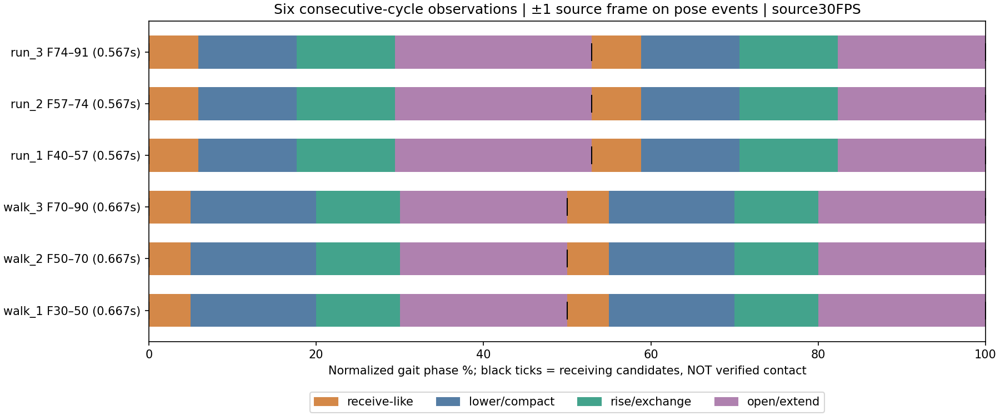

# Actions & Stuff — Player Deep Research

**2026-10-14 · GameAssetFactory · Research only · Chờ người dùng review.**

Mục tiêu: **Expressive Blocky + Snappy Timing + Contact-Driven Bounce + Responsive Gameplay**. Đây là định hướng nghiên cứu do người dùng yêu cầu, không phải xác nhận rằng một Snappy Action hiện tại đã đạt chuẩn. Giữ phong cách đã duyệt và cảm giác chuyển trọng lượng mềm, có kiểm soát **“nhúng nhúng”**. Không tạo Walk V029, không thay rig/mesh/Action/Showcase/Godot hay triển khai ba thí nghiệm dưới đây.

Đọc báo cáo này trước; dữ liệu và phương pháp nằm trong [hồ sơ nghiên cứu](research/actions_and_stuff_deep_2026_10_14/README.md). Các báo cáo cũ được liên kết theo đúng phiên bản, không sao chép toàn bộ lịch sử thử nghiệm vào đây.

## 1. Executive findings

1. **Sự hấp dẫn nằm ở quan hệ giữa các phần của bước chân.** Trong ba chu kỳ Walk và ba chu kỳ Run liên tiếp đã xem từng frame, đoạn thấp/thu gọn ngắn dẫn vào đổi chân–hồi lên nhanh, sau đó là khoảng mở chân dễ đọc hơn. Một sóng nhún đều, hoặc chỉ tăng độ cao/tốc độ, không mô tả được sự tương phản này. Đây là quan sát hình ảnh, chưa phải đường cong gốc của Oreville.
2. **Nhịp Run cần cập nhật so với nghiên cứu cũ.** Đoạn mới đối chiếu F40–91 có các tư thế tương ứng cách khoảng **17 frame / 0,567 s**, không phải 16 frame như ước lượng thô trước đây. Walk F30–90 lặp khoảng **20 frame / 0,667 s**. Chỉ áp dụng cho các đoạn ghi hình này; pack version và tốc độ ghi gốc chưa xác minh.
3. **Không thể suy ra chiều cao hông, góc xương hay thời gian chống chân chính xác từ các video front/rear hiện có.** Atlas giữ số đo pixel, ứng viên contact và độ tin cậy; không biến bóng dưới chân, chân bị khuất hay chuyển động camera thành bằng chứng về solver/physics.
4. **Các thử nghiệm của ta đã cải thiện một số vấn đề nhưng đang trả giá về silhouette/attachment.** V027/V028 có common hop; OneStep v001/v002 giữ support nhưng còn piston và khoảng hở eo. Kiểm tra kỹ thuật có thể chấp nhận khoảng hở đó trong giới hạn đã đặt, trong khi mắt người vẫn thấy nhân vật rời khối hoặc nhịp thiếu tự nhiên.
5. **Chất lượng clip và chất lượng điều khiển là hai bài toán liên quan nhưng khác nhau.** Main F5 WorldMap đang dùng nhánh V004/R6p; phòng thử Expressive có các adapter support khác. Không được coi kết quả ở một nhánh là đã áp dụng cho nhánh kia.
6. **Bước tiếp theo nên là ba phép thử có kiểm soát, không thêm một Walk hoàn chỉnh ngay.** Tách đường đi/thời điểm chân, phản ứng nhận trọng lượng, và phối hợp thân–vai–đầu. Chỉ ghép những thay đổi được người dùng thấy tốt hơn; sau đó mới xét Run và gameplay.

## 2. Verified source register và phạm vi thực sự đã xem

Quy ước: **D** tài liệu công khai nói rõ; **O** thấy trong ảnh/chuỗi frame đã chỉ định; **M** đo từ file/dữ liệu, có đơn vị/phương pháp; **H** giả thuyết giải thích; **P** đề xuất gốc cho project; **U** chưa biết. “Approved” chỉ có khi người dùng xác nhận, không đồng nghĩa D/O/M.

| Nhóm nguồn | Nội dung đã tiếp cận | Nơi truy vết / giới hạn |
|---|---|---|
| Tài liệu người dùng | Đã đọc `C:/Users/ADMIN/Downloads/Actions_Stuff_Player_Animation_Research.md`; người dùng xác nhận dùng bản này thay tên `(1)` | Đây là brief tổng hợp, không phải nguồn tiết lộ implementation. Các gợi ý tạo Action trong brief không được thực hiện vì yêu cầu hiện tại là research only. |
| Oreville | Guide/General, 1.6, 1.10, 1.11, Creators và mục mới hơn 1.12 | [Public evidence](research/actions_and_stuff_deep_2026_10_14/PUBLIC_SOURCES.md), [register JSON](research/actions_and_stuff_deep_2026_10_14/source_register_public.json). Đọc văn bản; không tuyên bố vừa xem toàn bộ trailer. |
| Mojang editorial, cộng đồng | Bài Let's Play và mẫu nhỏ gồm sáu bình luận từ hai thảo luận công khai | Cảm nhận định tính; không phải bằng chứng hiệu quả thương mại, độ gây nghiện hay khảo sát đại diện. Chi tiết/URL ở Public evidence. |
| Microsoft, Blockbench, Blender, Godot, Khronos | API/format/interpolation/blending/export | [Technical strategies](research/actions_and_stuff_deep_2026_10_14/TECHNICAL_STRATEGIES.md), [register](research/actions_and_stuff_deep_2026_10_14/source_register_technical.json). Một số trang Blender chỉ truy cập được văn bản index; không ghi là đã đọc đầy đủ trang. |
| Walk/Run gốc | Decode mới 304 + 349 frame, 30 FPS; xem 653 frame trong overview; phóng lớn toàn bộ Walk F30–90, Run F40–91 và rear F160–199 mỗi video | [Metadata/hashes](research/actions_and_stuff_deep_2026_10_14/source_media.json), sáu cycle sheets và atlas bên dưới. Video được xem qua chuỗi frame, không có tuyên bố nghe audio hoặc thử điều khiển. |
| Các animation của ta | Decode mới 652 frame từ 10 video front/side; xem 268 panel liên tiếp chứa đủ một vòng mỗi Walk, toàn bộ v001 và bốn bước v002 | [Comparison ledger](research/actions_and_stuff_deep_2026_10_14/compare_decode.json), [local audit](research/actions_and_stuff_deep_2026_10_14/LOCAL_AUDIT.md). Không mở/save Blender hoặc render lại source. |
| Hai video bổ sung trong khi nghiên cứu | Ghi hình `2026-10-14 045502` và `2026-10-13 043804` | [Showcase supplement](research/actions_and_stuff_deep_2026_10_14/SHOWCASE_SUPPLEMENT.md), [supplement 2](research/actions_and_stuff_deep_2026_10_14/SUPPLEMENT2.md). Giữ riêng provenance, nhân vật, camera và trạng thái; không nối thành một chu kỳ với clip gốc. |

Tài liệu nền đã đọc: [Style Guide](ANIMATION_STYLE_GUIDE.md), [Expansion Guide](ANIMATION_EXPANSION_GUIDE.md), [nghiên cứu locomotion trước](ACTIONS_AND_STUFF_LOCOMOTION_STUDY.md), [V028](WALK_SNAPPY_V028_MOTION_MATCHING_STUDY.md), và các source/validation được liệt kê trong local audit. Các báo cáo kiểm tra hình học/gameplay cũ là **bằng chứng lịch sử được đọc**, không phải test vừa chạy lại.

## 3. Điều đã biết và chưa biết về hệ thống Oreville

**D:** nguồn chính thức xác nhận mục tiêu chuyển động có liên tục qua trạng thái, điều kiện theo ngữ cảnh, tương tác với đồ cầm tay và feedback. Core locomotion vẫn không được công bố ở mức đủ để khôi phục controller hay keyframe. Public Creators API là ngoại lệ có tài liệu cụ thể cho compatibility; vì vậy câu “không biết bất kỳ implementation nào” cũng quá rộng. [Nguồn và phân biệt phạm vi](research/actions_and_stuff_deep_2026_10_14/PUBLIC_SOURCES.md)

| Có bằng chứng | Chưa được chứng minh |
|---|---|
| Hành vi mong muốn được mô tả trong release notes; các trường hợp reset/chuyển đồ từng cần sửa | Biểu đồ state đầy đủ, thứ tự ưu tiên, thời lượng blend, quy tắc lựa chọn chân |
| API tương thích item/attachable/mainhand/offhand được công bố | Mask thực tế của core locomotion, hệ IK, foot locking, motion matching |
| Chuỗi ảnh cho thấy thay đổi silhouette, nhịp nhận–hồi, bất đối xứng | Góc bone, pivot, biến dạng ẩn, phần trăm authored/procedural, loại curve gốc |
| Nền tảng Bedrock có expressions, controllers và các chế độ interpolation | Oreville sử dụng chính xác capability nào cho từng Action |
| Người dùng và một số bình luận thích cảm giác sinh động | Nguyên nhân nhân quả duy nhất, ưu thế nghệ thuật phổ quát, lợi nhuận hay “addictiveness” |

Không tìm thấy một phỏng vấn animator/breakdown core player đáng tin cậy trong đợt tìm kiếm có giới hạn này. Điều đó không chứng minh không tồn tại. Không dùng bản port, file pack trích xuất hay trang rehost làm bằng chứng nguồn.

## 4. Walking — phân tích frame và atlas chuyển động

**M:** `walking.mp4`, 246×356, 304 frame, 30 FPS, 10,133 s. Frame nguồn tính từ **0**; Blender trong tài liệu cũ tính từ **1**. Các điểm bắt đầu chu kỳ là mốc hình ảnh gần tư thế receiving, không phải contact vật lý đã xác nhận.

| Chu kỳ | Nguồn / thời gian | Ứng viên receiving xen kẽ | Độ tin cậy |
|---|---|---|---|
| W1 | F30–50, 1,000–1,667 s | F30 / F40 / F50 | Lặp silhouette: khá cao; contact: thấp, ±1 frame |
| W2 | F50–70, 1,667–2,333 s | F50 / F60 / F70 | Camera đổi nền nhiều hơn; không lấy độ cao đã “ổn định camera” làm chuẩn |
| W3 | F70–90, 2,333–3,000 s | F70 / F80 / F90 | Nhịp hình ảnh tương ứng; orientation không giống hệt W1 |

Tại mốc đầu, chân dài nổi bật ở **screen-right**, tạm gọi chân trái nhân vật nếu video không mirror; nửa sau đổi sang screen-left. Atlas giữ screen side làm dữ liệu chính vì chưa xác minh mirror. Cùng một chân xuất hiện “ngắn” có thể do foreshortening/occlusion, không chứng minh co gối hay rút ngắn xương.

| W1, frame / pha | O — quan sát trong chuỗi liên tiếp | H / U |
|---|---|---|
| F30–31, 0–5% | Chân trước còn dài, cap và áo bắt đầu hạ; tay mang đồ không đồng dạng tay trống | Receiving/acceptance candidate; chưa xác nhận frame đầu đế chạm đất |
| F31–33, 5–15% | Khối trên hạ/thu gọn trong thời gian ngắn, chân đối diện foreshorten | Hợp với cách đọc “nhận trọng lượng”; không đo được COM hay lực |
| F33–35, 15–25% | Thân hồi lên, hai chân nhanh đi qua cấu hình hẹp | Recovery/pass cluster; push-off và thời gian flight chưa xác định |
| F35–39, 25–45% | Chân mới dần dài hơn; cap tiếp tục đổi độ nghiêng, tay vẫn dịch chuyển | Khoảng cho silhouette được đọc; không phải hold đứng im |
| F39–40, 45–50% | Chân screen-left chiếm ưu thế, sắp vào đợt hạ tiếp | Placement/reversal candidate |
| F40–50, 50–100% | Lặp quan hệ trên ở phía đối diện, không phải bản mirror tuyệt đối của toàn thân | Item và góc camera khiến hai nửa khác nhau |

W2/W3 cho cùng thứ tự ở các frame cộng 20/40. Đó là kiểm tra qua nhiều bước, không chỉ chọn một pose đẹp. Rear F160–199 xác nhận chân/vai đổi bên và thân không phải một khối cứng chuyển cùng lúc; khác camera nên không lấy cùng y-pixel làm độ cao vật lý.

[W1 đầy đủ](research/actions_and_stuff_deep_2026_10_14/walk_cycle_1_F30_50.jpg) · [W2](research/actions_and_stuff_deep_2026_10_14/walk_cycle_2_F50_70.jpg) · [W3](research/actions_and_stuff_deep_2026_10_14/walk_cycle_3_F70_90.jpg) · [rear](research/actions_and_stuff_deep_2026_10_14/walk_rear_context_F160_199.jpg).

## 5. Running — chuỗi riêng, không phải Walk tua nhanh

**M:** `Running.mp4`, 250×380, 349 frame, 30 FPS, 11,633 s. Các mốc tương ứng mới: **F40 / 57 / 74 / 91**, khoảng 17 frame. Mốc đối diện F49 / 66 / 83 nằm gần 53% pha; độ lệch 50→53% nằm trong độ phân giải ghi hình, **không đủ kết luận support hai bên bất đối xứng**.

| Chu kỳ | Thời gian thật trong file | Ứng viên receiving | Phạm vi |
|---|---|---|---|
| R1 F40–57 | 1,333–1,900 s | 40 / 49 / 57 | Camera/nền thay đổi; cap mask F50 mất, giữ null |
| R2 F57–74 | 1,900–2,467 s | 57 / 66 / 74 | Đủ hình đổi chân; không suy ra world height |
| R3 F74–91 | 2,467–3,033 s | 74 / 83 / 91 | Có quay/góc nền khác; pose repeat vẫn đọc được |

| R1 frame / pha | Quan sát | So với Walk |
|---|---|---|
| F40–42, 0–12% | Chân screen-left dài rồi khối trên hạ; chân kia foreshorten nhanh | Receiving-like episode ngắn hơn theo thời gian ghi |
| F42–44, 12–24% | Cấu hình chân hẹp/đổi, thân và cap hồi lên | Exchange tập trung; không phải giữ chân duỗi suốt pha trên không |
| F44–49, 24–53% | Chân đối diện mở ra, item/arm tiếp tục thay đổi; cap có độ nghiêng riêng | Silhouette có năng lượng và không đối xứng hơn, không chỉ tăng cadence |
| F49–53, 53–76% | Đợt hạ và đổi chân ngược lại | Nhịp thứ hai tương ứng nhưng không pixel-identical |
| F53–57, 76–100% | Mở chân trở về họ tư thế đầu | Nối nhịp qua bước, không chèn neutral pause |

R2/R3 kiểm tra cùng họ tư thế bằng offset +17/+34, đã có người kiểm tra độc lập từ pixels. Ước lượng 16 frame trong nghiên cứu 2026-10-13 được **thay thế cho đoạn này**; không đổi thành một quy luật “Run của pack luôn 17 frame”.

Không dùng phần front cuối F292–348 như bằng chứng running ổn định: phần lớn là dáng gần đứng/yên và chuyển động nhẹ, khác setup. Clip có bụi và bóng; chúng không phải contact sensor. Grounded/airborne intervals chính xác vẫn để **unknown**. Run tương lai cần tự thiết kế support/flight có chủ đích, không chép phần trăm từ bóng.

[R1 đầy đủ](research/actions_and_stuff_deep_2026_10_14/run_cycle_1_F40_57.jpg) · [R2](research/actions_and_stuff_deep_2026_10_14/run_cycle_2_F57_74.jpg) · [R3](research/actions_and_stuff_deep_2026_10_14/run_cycle_3_F74_91.jpg) · [rear](research/actions_and_stuff_deep_2026_10_14/run_rear_context_F160_199.jpg).

## 6. Snappy timing, spacing và giới hạn số đo

Timeline là nhãn các **họ tư thế nhìn thấy**, không phải phân vùng stance/flight. Chuẩn hóa theo `100 × (frame − start)/(closing − start)` để so quan hệ; giữ nguyên thời lượng thật, không retime video. Mỗi quan sát có frame/timestamp/pha/confidence trong [CSV](research/actions_and_stuff_deep_2026_10_14/frame_observations.csv) và [cycle contracts](research/actions_and_stuff_deep_2026_10_14/cycles.json).

**M:** trong ba bước đầu được chọn, cap mask hạ khoảng 21,6 / 23,3 / 35,4 pixel ở Walk; Run 15,2 / 30,0 / 23,7 pixel. Sự chênh lệch giữa các chu kỳ là lý do **không** đổi các số này thành mm bounce hoặc mục tiêu amplitude. Cap nghiêng, camera chuyển và perspective đều góp phần. [Số đo/missing data](research/actions_and_stuff_deep_2026_10_14/proxy_statistics.json)

[Walk screen curves](research/actions_and_stuff_deep_2026_10_14/walk_screen_proxy_curves.png) và [Run screen curves](research/actions_and_stuff_deep_2026_10_14/run_screen_proxy_curves.png) hiển thị raw và background-translation-corrected riêng. Correction bằng optical flow không phải calibrated camera solve; drift tích lũy, nhất là chu kỳ 2, bị loại khỏi suy luận world height. Không lấy đạo hàm bậc hai/bậc ba của centroid nhiễu để khẳng định acceleration/jerk gốc.

**O/H:** tương phản rõ hơn nằm ở thời gian ngắn của đoạn thấp/đổi chân và đoạn mở dễ đọc, không ở một tỉ lệ tốc độ duy nhất. Đường mượt vẫn có thể snappy nếu vận tốc thay đổi có chủ đích. Ngược lại, zero velocity ở mọi key sẽ tạo các mini-stop dù endpoints liên tục. Không thấy bằng chứng đủ mạnh về hold neutral cố ý trong sáu chu kỳ; ảnh gần giống không chứng minh tác giả đặt hold.

Ở 30 FPS, một frame là 33,3 ms. Sai số mốc ±1 frame đủ lớn để làm một delay 45–60 ms chỉ còn khoảng 1–2 lần lấy mẫu. Vì vậy không chốt độ trễ đầu/vai bằng một số ms “đo từ reference”. Chọn thứ tự sự kiện và kiểm tra native spacing trước.

## 7. Bounce và cơ chế nhận trọng lượng

**H:** mắt đọc weight khi chân nhận → thân tiếp tục hạ có kiểm soát → hồi lên đồng thời chân kia thu qua → tư thế mở chuẩn bị nhận tiếp. Đây là mô hình giải thích có ích cho ta, không phải lực đã đo của reference.

Điểm khác với generic bobbing là **sự phụ thuộc vào sự kiện**: đổi thời điểm contact phải khiến load/recover thích ứng, dừng thì không còn nhún theo timer độc lập, landing không cộng thêm một dip sai pha. Body minimum không bắt buộc trùng frame touchdown; nó có thể đến sau để thể hiện hấp thụ. Nhưng khoảng đó phải hợp với support và rig của ta.

V027 có các crest body/common-hop/piston lệch nhau theo báo cáo đã lưu. V028 gom chúng lại và tạo hồi lên nhanh hơn, nhưng vẫn mang flight và silhouette khác. OneStep loại common hop, giảm body range và giữ chống chân; nó chưa giải quyết triệt để attachment của chân khối. Không thể dùng “không xuyên đất” thay cho một pose nhận trọng lượng đẹp.

Trong engine, capsule/physics giữ quyền điều khiển quỹ đạo. Visual compression không được nâng/hạ collision body thêm một lần hoặc trì hoãn input chỉ để chạy hết một anticipation đẹp. Chất lượng contact phải đo ở pose cuối sau weapon/turn/correction.

## 8. Upper body, overlap và personality

**O:** cap đổi độ nghiêng trong khi leg silhouette mở/khép; ngực, item và tay trống không giữ cùng hình dạng tương đối suốt bước. [Item/chân Walk](research/actions_and_stuff_deep_2026_10_14/walk_limb_proxies.png) · [Run](research/actions_and_stuff_deep_2026_10_14/run_limb_proxies.png). Item centroid được đo tương đối với vùng áo nên bớt ảnh hưởng camera translation, nhưng vẫn chịu rotation/occlusion; đó không phải wrist joint.

Shoe-mask dữ liệu bị thiếu khi hai giày nhập hình hoặc bị che, đôi lúc lẫn chi tiết đồ cầm. Nó được giữ như **chẩn đoán segmentation**, không dùng suy ra continuous foot path hay acceleration. Shirt hem cũng không phải hip joint. [Các phép đo bị loại và lý do](research/actions_and_stuff_deep_2026_10_14/measurement_limits.json)

**P:** ta cần một chuỗi phản ứng đọc được, không một loạt dao động riêng: chân/hông tạo sự kiện; chest nhận rồi trả lực; shoulder/arm còn tiếp tục arc; đầu giữ chú ý với một chút follow-through. Không cố làm mọi part đạt đỉnh cùng lúc. Cũng không mặc định rằng càng tăng lag, xoay hay biên độ thì càng giống.

Tay mang đồ là confound lớn. Trước tiên kiểm tra unarmed so với unarmed; sau đó dùng một item của ta, giữ grip và cho tay còn lại có chức năng riêng. Torso pitch/roll/yaw chính xác của source chưa giải được từ front video. Bản chuyển thể gốc có thể đạt cảm giác tương tự bằng xoay nguyên khối và spacing, dù không thể tái tạo một silhouette cần gập khuỷu/gối.

## 9. Bedrock animation/controller findings

Bedrock cho phép kênh bone/expressions, state transitions và animation events; schema được đọc liệt kê linear/Catmull-Rom cùng điều khiển animation time. Đó là capability của nền tảng, **không xác nhận lựa chọn của Oreville**. Controller crossfade theo thời gian không tự bảo đảm cùng chân chống. [Microsoft overview](https://learn.microsoft.com/en-us/minecraft/creator/documents/animations/animationsoverview?view=minecraft-bedrock-stable), [controller reference](https://learn.microsoft.com/en-us/minecraft/creator/documents/animations/animationcontroller?view=minecraft-bedrock-stable)

Không chuyển nguyên logic Molang qua GLB rồi kỳ vọng nó chạy trong Godot. Cần phân biệt shape được bake với điều kiện/runtime logic. Blockbench có tài liệu expression/bake nhưng sự tồn tại của công cụ/template không chứng minh toàn bộ A&S được author trong đó. [Blockbench expressions](https://blockbench.net/wiki/guides/animation-expressions/)

Ma trận [13 kỹ thuật](research/actions_and_stuff_deep_2026_10_14/TECHNICAL_STRATEGIES.md#technique-matrix) trả lời đủ năm câu hỏi cho mỗi kỹ thuật: tác dụng, đóng góp có thể có, bằng chứng A&S, cách làm gốc Blender/Godot, và phép thử phân biệt tốt/xấu. Nó bao gồm spacing, interpolation, anticipation, overlap, arcs, overshoot, rigidity, contact, phase, authored/procedural, layers, interruption, audio/FX.

## 10. Chiến lược Blender → Godot của ta

**P:** giữ rig và sampler hiện tại; bắt đầu bằng một contract rõ cho clip: finite/loop, duration, receiving/release/pass của mỗi chân, nominal travel, coordinate space, absolute/additive, track ownership, reference pose. Không đổi renderer/AnimationTree hay xây rig mới chỉ để thử một giả thuyết timing.

Trong Blender, kiểm tra world-space sole corners, waist, head/chest và silhouette theo camera thật. Curve bone mượt chưa chứng minh sole mượt. Nếu cần sửa timing ở body nhưng muốn giữ chân thế giới, phải bake compensation đúng hierarchy và báo rõ thay đổi đó; không giấu một sửa pose lớn dưới tên “chỉ đổi timing”.

Trong Godot, **phase-alignment ≠ foot-lock**. StateMachine Sync chuyển thời gian phát, còn cyclic sync có ngữ nghĩa khác; cả hai đều cần cùng ý nghĩa receiving của clip. Project khai báo Godot 4.7/Mobile, nhánh gameplay thực tế dùng custom pose writer. Các capability 4.7 được kiểm tra bằng docs đúng version, không áp ví dụ `latest` trực tiếp vào runtime. [Godot 4.7 AnimationTree](https://docs.godotengine.org/en/4.7/tutorials/animation/animation_tree.html)

Ưu tiên data/diagnostics quanh hệ hiện có: log unwrapped phase, support side, actual displacement, final sole; một nơi phát contact events; một pose writer cuối. Correction phải có giới hạn reach và có cách release/replant khi không thể giữ. Full-body absolute Action không được cộng như additive delta. Weapon/aim và visual bounce cần ownership riêng, tránh cùng sửa một transform hai lần.

## 11. So với Approved Walk, V027, V028 và OneStep

So sánh dùng đủ chu kỳ native front/side, không retime rồi gọi là cùng cadence. Approved Walk **1,2 s / 0,9 m/s nominal**, các Snappy **0,7 s / 1,59936 m/s nominal**; speed khác là confound phải giữ trong kết luận. Các số hình học sau lấy từ **report lịch sử**, chưa chạy lại.

| Phiên bản | Điều đã đạt theo evidence | Điều còn khác / chưa được chứng minh |
|---|---|---|
| Approved Walk | Hip range 22 mm; chuyển trọng lượng nhẹ, chân thấp và pose yên hơn; baseline nghệ thuật đã được duyệt | Không được tự thay bằng Snappy; approval Blender không tự chứng nhận mọi transition |
| V027 | Descent chân dịu hơn; giữ nhiều phần từ version trước | Body tương đối đều; các event từng chạy theo clock khác nhau; common hop còn rõ |
| V028 | Shared timing; crest/pass sớm hơn; peak body rise 2,915 so với 1,372 m/s V027 | Peak speed cao không phải điểm số đẹp; silhouette nhận, flight, đồ cầm/camera còn khác |
| OneStep v001 | Một bước để review, support giữ đất | Finite 13 sample, chưa có continuation; waist gap lịch sử tới 61,7 mm |
| OneStep v002 | Bốn bước liên tục, contact authored 0/.35/.7/1.05/1.4 s; cùng rig | Không phải production loop/start; còn waist gap 60,2 mm và piston; chưa được người dùng duyệt |

Xem [audit + đủ 12 comparison sheets](research/actions_and_stuff_deep_2026_10_14/LOCAL_AUDIT.md). Bản README Walk cũ có chữ Pending nhưng manifest/current approval xác nhận Approved; audit giữ sự phân biệt này thay vì hạ trạng thái tài sản.

**Năm khoảng cách ưu tiên**, xếp theo tác động dự kiến, không phải chứng minh nhân quả:

1. **Silhouette nhận lực, hình hồi chân và attachment** — khác biệt nhìn thấy rõ; ảnh hưởng lên cảm giác là H. Chân dài thẳng + piston/waist gap có thể làm bước trông rời khối dù footprint đúng.
2. **Spacing và phối hợp sự kiện** — khác biệt timing có dữ liệu; cần giữ một động tác chính đọc được thay vì đẩy tất cả cực trị mạnh hơn. V028/v002 đã thử một phần, chưa có artistic verdict.
3. **Chuyển support đúng trên actor F5** — thiếu bảo đảm từ code hiện tại; hệ lab tốt hơn ở vài mặt không tự xuất hiện trong main.
4. **Bất đối xứng có chức năng của upper body** — reference có đồ cầm/góc quay khác; ta cần arc/negative space phù hợp chính nhân vật mình, không copy side lệch.
5. **Trình bày ở gameplay scale và feedback** — chưa có thử đối chứng camera/audio/terrain/device; không gọi toàn bộ cảm giác là thuộc riêng curve.

Một test có thể cho qua khoảng hở dưới giới hạn 75 mm nhưng mắt vẫn thấy thiếu gắn kết. Pose/tangent seam đúng chỉ loại được pop; nó không đo appeal, personality, đủ thời gian đọc tư thế hay input satisfaction. Các estimator seam thay đổi trong lịch sử cũng phải giữ nhãn đúng; một pass mới không biến raw legacy fail thành pass.

## 12. Rig capability và giới hạn

| Nguồn giới hạn | Điều có thể làm nhỏ nhất bằng rig hiện tại | Điều không nên hứa |
|---|---|---|
| Chân nguyên khối, không gối/ankle | Hip rotation, toàn chân dịch/xoay có kiểm soát, sole-edge support, body/chest phản ứng | Crouch sâu, swing thu ngắn như chân gập và attachment kín đồng thời |
| Tay thẳng, giữ đủ bàn tay | Shoulder arc và bounded offset, torso opposition, hand/grip pose phù hợp | Tái tạo silhouette cần khuỷu gập mà không thay style |
| Pivot / hierarchy | Đánh giá full chain và compensation trong pose; giữ rest rig | Suy pivot từ ảnh phối cảnh hoặc đổi bind pose vì một frame |
| Tỷ lệ cơ thể | Thiết kế negative space, nhận lực và spacing cho chiều dài chân của ta | Khớp pixel của skin/nhân vật có tỷ lệ khác bằng tăng amplitude |
| Interpolation / sampling | Nonzero through-velocity ở transit, braking rõ, kiểm tra subframe và native30FPS | C2 tự động đẹp; dense keys tự động tốt trên điện thoại |
| Controller / camera | Giữ input/collision immediate, support-aware visual adapter; compare trong camera cố định | Blend dài che được mọi chân sai hoặc video front dự đoán đúng camera gameplay |

**P:** trước khi đổi rig, đánh giá một bộ ba pose gốc nhận–thu/hồi–mở với attachment có thể chấp nhận. Nếu cùng constraint không thể đạt, chỉ rõ tradeoff, không nới guard rồi tuyên bố đã giống. Không có thay rig được đề nghị như mặc định trong nghiên cứu này.

## 13. Gameplay feel, transitions và feedback

**M-code:** `project.godot` → WorldMap → `CuboidPlayerJumpGifV004`; R6p giữ normalized clock tiến theo clip time khi moving. Lab Expressive có `speed/stride`, support adapters và replants riêng. Main có live-gait blending ở jump/landing, nhưng chưa đủ chứng minh support đúng. [Exact file/line audit](research/actions_and_stuff_deep_2026_10_14/LOCAL_AUDIT.md#current-runtime-two-separate-paths)

| Tình huống | P — tiêu chí hành vi gốc | Phép kiểm chứng sau khi được cho phép |
|---|---|---|
| Start / stop / short taps | Input phản hồi ngay, free foot có placement hợp lệ, không đợi hết trang trí | Cùng input script, cả hai lead, stop ở nhiều pha; input-to-motion và sole drift |
| Walk ↔ Run / acceleration | Giữ ý nghĩa support; đổi cadence/stride không reset leg | Chuyển ở ít nhất 16 pha, tăng/giảm speed, bấm vào tường, actual travel vs clock |
| Jump | Chọn hoặc thích nghi với support đang có; physics sở hữu flight | Cả hai chân lead, đứng/đi/chạy, hold jump rồi sprint; không reset giữa air |
| Landing → move | Contact thật trước load; còn input thì tiếp tục gait phù hợp | Landing ở các pha/direction, mặt phẳng/bậc, dừng ngay sau chạm |
| Turn / reversal | Facing/capsule responsive; release/replant anchor không thể giữ | 45/90/180°, đổi hướng liên tiếp, kiểm tra pose cuối với weapon |
| Combat strafe / equipment | Gaze/weapon ownership rõ; chân phục vụ hướng thực tế | Aim + moving + draw/holster/use/cancel; không double writer hoặc grip pop |
| Idle | Nhẹ và có thể ngắt; nhịp thở khác receiving | Vào/ra từ cả hai support, không phase reset gây giật đầu |

Nguồn Oreville mô tả continuity và interruption như mục tiêu hành vi; thuật toán của ta vẫn là P. Chi tiết release/version và các lỗi input-order nằm ở [public evidence](research/actions_and_stuff_deep_2026_10_14/PUBLIC_SOURCES.md).

**Audio/VFX/camera:** feedback có thể làm bước thuyết phục hơn nhưng chưa được cô lập bằng thử nghiệm. Không có phân tích nghe audio trong task này. Source audit chưa tìm thấy footstep dispatcher trên runtime đang xét; legacy spring-contact timer không phải event final support. Đề xuất cùng clip/camera: muted → contact audio → FX, mỗi lần thêm một nhóm. Âm thanh chỉ được phát một lần cho contact được chấp nhận, không cả hai clip đang blend; camera không được che mất skating. Khảo sát cộng đồng nhỏ chỉ gợi ý các tiêu chí như sinh động, tùy chọn intensity/texture và hiệu năng, không xác nhận cơ chế gây thích thú.

## 14. Ba thí nghiệm có kiểm soát — CHƯA TRIỂN KHAI

Thiết kế thí nghiệm dùng **cùng nhân vật, appearance, camera, floor, hướng, nominal speed và thời gian bước**. Giữ v002 như baseline nghiên cứu riêng, không sửa nó; Approved Walk là chuẩn phong cách bảo tồn ở tốc độ gốc, không ép tua nhanh rồi gọi là đối chứng tốc độ tương đương. Mỗi thay đổi cần một bản đối chứng, frame strips native và review 1×; không thêm dust/bloom/audio để che lỗi.

### A — Hình hồi chân và phân bố swing

- **H:** khoảng hẹp/exchange cần ngắn nhưng vẫn đọc được; đuổi theo peak lift đang làm piston nổi hơn ý định bước.
- **Biến:** timing/arc swing giữa các contact cố định; orientation tại recovery/pass/braking. Giữ body/head/arms, cadence, reach endpoints và support convention. Nếu cần compensation để giữ contact, ghi lại rõ.
- **Evidence:** Walk F31–40 và hai lần lặp; Run dùng để phân biệt, không làm target Walk. Chưa có profile chân đủ tốt để khẳng định exact 3D path.
- **Kỳ vọng:** chân thu qua có hướng, mở ra có phanh; không một frame “teleport”, không mất chân vào áo.
- **Review:** full native30FPS front/side/gameplay; traces sole corners; A/B thứ tự ẩn tên nếu thuận tiện.
- **Thành công:** người dùng ưu tiên arc/readability, contact/attachment không xấu hơn baseline. **Thất bại:** cảm giác chỉ nhanh hơn, piston/waist lộ hơn, phải nới guard hoặc làm cadence khác mới thấy tốt.

### B — Receiving-driven body recovery

- **H:** quan hệ contact → low → hồi lên tạo weight tốt hơn một body oscillator không gắn event.
- **Biến:** thời điểm minimum, phân bố rise/settle; giữ range ban đầu và chân thế giới của baseline nếu rig cho phép. Không tăng common hop để che reach.
- **Evidence:** cap/shirt low-recover order lặp, không lấy pixel range làm mm hông. V027→V028 cho thấy cùng range có thể đổi spacing mạnh.
- **Kỳ vọng:** load ngắn rõ, hồi có lực rồi mở; giữ nét “nhúng nhúng” mềm, không thành pogo liên tục.
- **Review:** solo body plot + full mesh; cùng camera/native30FPS; kiểm tra waist/head/floor trong toàn khoảng.
- **Thành công:** nhận lực đọc được hơn ở muted1×, không thêm beat/flight ngoài brief. **Thất bại:** đẹp ở slow motion nhưng giật ở1×, gap tăng, contact bị bẻ hoặc amplitude bị đổi lén. Nếu không khả thi hình học, báo constraint thay vì nới giới hạn.

### C — Quan hệ torso–shoulder–head, không tăng sway chung

- **H:** chuyển động chính cần các phản ứng phụ lệch pha có chức năng để rigid blocks không cùng đảo hướng.
- **Biến:** event-relative timing/arc của chest, shoulder/arm và head; lower-body world trajectories giữ nguyên. Unarmed trước, thêm một item ở bước review riêng.
- **Evidence:** cap slope và item/free-arm asymmetry nhìn thấy; exact lag/3D yaw chưa biết. Video bổ sung được dùng để kiểm tra xem bất đối xứng có còn khi tay trống.
- **Kỳ vọng:** chest nhận/trả, tay còn tiếp arc, đầu có chủ đích và không lắc vô cớ.
- **Review:** front/side/three-quarter/gameplay, overlay timing theo event; equipped variant phải giữ hai grip nếu có.
- **Thành công:** silhouette sống động hơn mà head/weapon đọc tốt, không giống các lớp dao động rời. **Thất bại:** chỉ “lắc nhiều hơn”, shoulder rời, mặt nhấp nhô hoặc aim/clearance hỏng.

Sau khi review từng phép: giữ baseline + các winner; ghép A+B rồi kiểm tra tương tác, sau đó thêm C. Không giả định ba thay đổi tốt riêng sẽ tốt khi cộng. Chỉ khi người dùng chấp nhận rhythm tổng thể mới tạo chu kỳ Walk có entry/exit contract; Run triển khai riêng sau Walk. Runtime prototype và audio là các bước tiếp theo cần được cho phép, không nằm trong task này.

## 15. Rubric chất lượng và giới hạn chấp nhận

| Trục đánh giá | Evidence cần có | Cách quyết định |
|---|---|---|
| Silhouette / attachment | Front/side/gameplay native size; đủ mọi frame | Người dùng đọc được chân nào dẫn, khối gắn hợp lý; không chỉ đẹp ở extrema |
| Nhịp / contrast | ≥3 chu kỳ liên tiếp native1×, timing strip | Có đoạn nhận–hồi–mở rõ; không giả hold/reset; user preference là verdict nghệ thuật |
| Weight | Support → low/recover order + video muted | Cảm giác đặt chân chịu trọng lượng, không nổi/lún hoặc bob độc lập |
| Upper coordination | Part timing + full pose | Một động tác chính, phản ứng phụ rõ nhưng không floppy |
| Contacts / geometry | Evaluated world sole/clearance/rigidity + cảnh thực | Technical gate tách khỏi aesthetic; giữ estimator/threshold provenance |
| Responsiveness / transitions | Input và final-pose logs + gameplay clip | Báo median/p95/worst latency, support errors, cancel cases; không chờ clip hết để nhận input |
| Equipment | Unarmed/armed matching trial | Grip, aim và ownership không bị locomotion phá |
| Mobile readability / cost | Thử máy mục tiêu thật, p95/p99 frame time và thermal | Mục tiêu30FPS; chưa chọn minimum phone nên chưa có phone certification |

Không gộp thành một điểm “giống reference 92%”. Có thể chấm 1–5 cho từng trục để ghi ý kiến người dùng, kèm frame và lý do; không lấy tổng điểm bù cho vi phạm geometry hoặc input. Đánh giá đẹp hơn reference là review thực tế, không kết luận tự động của agent.

## 16. Bước tiếp theo và những dữ liệu còn thiếu

**Khuyến nghị:** review báo cáo + atlas + bốn bước v002 hiện có, chọn việc ưu tiên attachment/arc hay timing trước; nếu đồng ý chiến lược, bắt đầu **Experiment A** ở phạm vi ngắn, đối chứng rõ, chưa thêm một production Walk. B và C chỉ tiếp sau khi biết A giải được gì. Không xem kết quả nghiên cứu là cho phép triển khai.

Để đo sâu hơn, nguồn có giá trị nhất tiếp theo là clip **known version/settings, unarmed, profile/three-quarter cố định, nền có lưới, normal speed**, ít nhất ba chu kỳ Walk/Run và input overlay cho start/stop/turn/jump/land. Video hiện có đủ phân tích quan hệ hình ảnh, chưa đủ khôi phục exact stance/flight, physical height hay latency. Không yêu cầu quyền truy cập file animation proprietary.

Các nguyên tắc mở rộng sang Idle/Jump/Landing/Strafe/Weapon là giữ **event, support, ownership và interruption** nhất quán; không áp chung một tần số nhún cho mọi state. Giữ nguồn Approved và những thử nghiệm Pending nguyên vẹn. Tài liệu và dữ liệu mới là kết quả của task; quyền quyết định nghệ thuật và bước triển khai tiếp theo thuộc người dùng.
