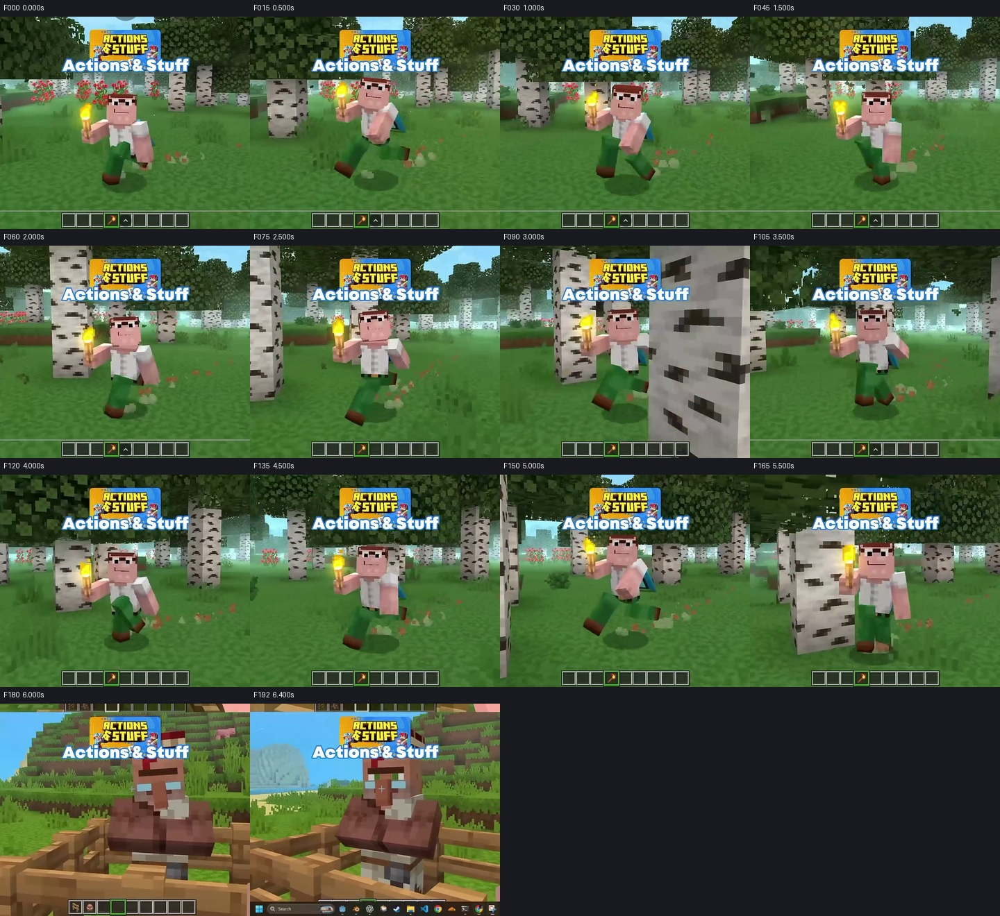
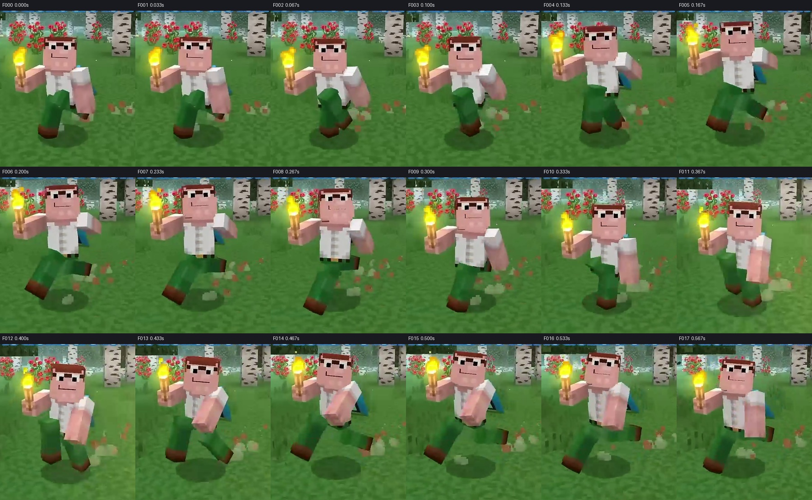
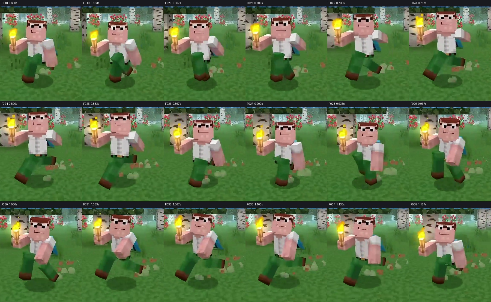
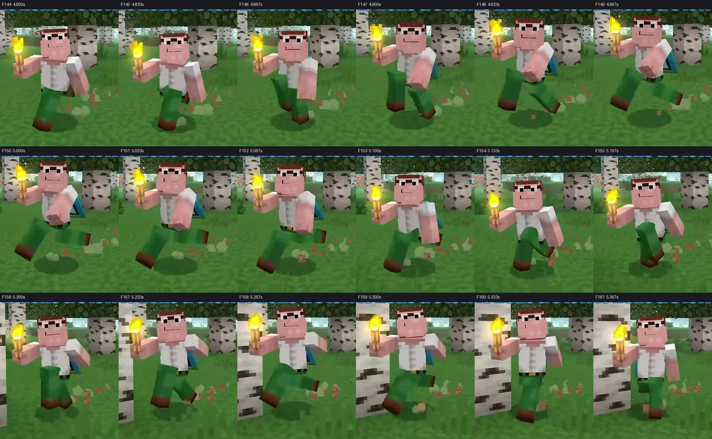
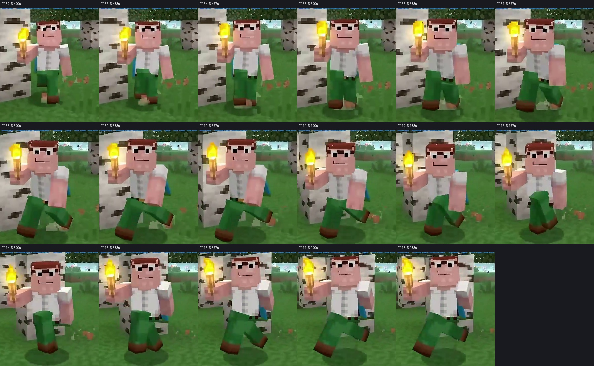

# Supplement 2 — added 2026-10-13 043804 screen recording

2026-10-14. Actual local video decoded and visually inspected for this supplement. Research only; no animation or gameplay changes.

The useful addition is **energetic frontal torch-carry locomotion with a quieter, more compact gait presentation near the end**. The raised item arm stays readable while the free arm changes substantially. This strengthens the case for coordinating upper-body context with the live gait. It does not reveal a rig, controller, contact solver or original animation curves.

## File identity and inspection

Source: [Screen Recording 2026-10-13 043804.mp4](<C:/Users/ADMIN/Videos/Screen Recordings/Screen Recording 2026-10-13 043804.mp4>). SHA256: `2b0f8d5d726b7f22d6d40f4046cc5866a87ab0d0a0623eeb7de9e5249b4cc97e`.

| Decoded property | Result |
|---|---:|
| Encoded frame rate | 30 FPS |
| Decoded / reported frames | 193 / 193 |
| Image size | 806 × 686 |
| Duration from frame count | 6.4333 s |
| First-to-last sample span | 6.4000 s |
| Exact adjacent whole-image repeats | 0 |
| Player locomotion segment | F0–178, 0–5.933 s |
| First villager frame after cut | F179, 5.967 s |
| Villager close-up segment | F179–192 |

Frame numbers are **zero-based**; nominal recorded time is frame/30. No repeated whole images does not prove there are no holds in a limb: the camera, flame, particles and background also change. Decode timestamps and frame-difference values are preserved in [supplement2_decode.json](supplement2_decode.json). Reproduction uses [supplement2_decode.py](supplement2_decode.py) with the specified Python 3.13 runtime; OpenCV sequentially reads the actual source without editing it.

This is **not byte-identical** to the 241-frame newer Walk reference previously used in v008/v025/v026/v027/V028. That file was `C:/Users/ADMIN/Desktop/Screen Recording 2026-10-13 052636.mp4`, SHA256 `b7257e8fea64e0ea2327b85c7e2441d6bfda2168c35ce7b07ea173e63949248e`, as recorded in [the earlier reference report](../../../../blender/animation/reviews/player_animation_library_v1/walk_snappy_test_v1/bounce_timing_v008/reference_analysis.json). Different bytes and frame counts establish different files, not necessarily an independently produced underlying demonstration. Their pack version and recording provenance are unestablished.

The actual overview and **all 193 consecutive frames** were inspected in six sheets. Enlarged consecutive crops were additionally inspected for F0–35 and F144–178. Full-frame F78–95 was checked to distinguish camera/framing changes from character motion. These are actual decoded pixels; no synthetic views, stabilized reconstructions, retimed sequences or missing continuation were created.

Complete sheets: [F0–35](supplement2_all_frames_000.jpg), [36–71](supplement2_all_frames_036.jpg), [72–107](supplement2_all_frames_072.jpg), [108–143](supplement2_all_frames_108.jpg), [144–179](supplement2_all_frames_144.jpg), [180–192](supplement2_all_frames_180.jpg).

## Visible states and camera limits

**O** means directly visible in this recording. **H** is a plausible interpretation. **U** remains unknown. **P** is an original adaptation to test on our character.

| Interval | O — visible content | H / U — what it establishes or does not |
|---|---|---|
| F0–77, 0–2.567 s | Frontal character travels through a birch forest; alternating broad leg openings, high compact recovery silhouettes, free-arm sweeps, raised torch and trailing blue back accessory. Trees/background move relative to the centered character. | **H:** energetic run-like presentation. Input, actual speed, sprint flag, animation state name and original playback speed **U**. Recording begins already moving; no Idle-to-Run start. |
| F78–95, 2.600–3.167 s | Foreground birches cross the image; character becomes much larger around F83–89, then smaller around F90 as a trunk occupies the right foreground. Gait continues. | Camera distance/framing changes materially. Do not derive a body-height pulse or acceleration from raw screen size here. No clear authored locomotion cut is identified in this interval. |
| F96–160, 3.200–5.333 s | Broad alternating strides and strong free-arm movement continue in frontal/near-frontal view. Torch remains raised. The background and relative character scale still vary. | Repeated movement context, not a controlled stationary-camera gait capture. Subtle heading variation does not demonstrate a 45/90/180° turn transition. |
| F161–167, 5.367–5.567 s | Free arm sits lower, the leg silhouettes become closer, and large opening/recovery poses diminish. Character continues moving beside a foreground tree. | **H:** candidate energetic-to-compact gait transition or deceleration. Could involve input, obstruction, camera/heading or context. No confirmed Walk/Run state switch or measured blend duration. |
| F168–178, 5.600–5.933 s | Alternating legs open again with a quieter upper body; torch arm still raised; movement continues until the edit. | **H:** walk-like compact continuation. The short remaining interval does not establish a complete steady Walk cycle or a final stop. |
| F179–192, 5.967–6.400 s | Hard cut to a villager behind a wooden fence, arms held together, head changing angle. Taskbar appears along the bottom at the end. | Separate subject/shot. It is not the player's stop/idle transition; cannot bridge this edit into a gait conclusion. |

The large Actions & Stuff branding and hotbar establish what is displayed, not pack version or timing fidelity. The source might be playback of edited demonstration material rather than an untouched engine capture. No source audio analysis or input telemetry was performed.

## Dense first-sequence evidence

Both sheets use the same fixed source rectangle `(220,175)–(610,625)` enlarged to 300-pixel-wide tiles. The crop never recenters or resizes with the character. Frame labels retain source times. Original uncropped frames remain in the complete sheets.

| Frames | O — coordinated silhouette change | What this adds |
|---|---|---|
| F0–3, then F18–20 | One low leg dominates; the other draws up into a compact silhouette near the waist as the stance relationship exchanges. The free arm changes from low toward rear/side. | Recovery is a short sequence of changing silhouettes, not a motionless neutral between open strides. Exact joint construction and sole contact **U**. |
| F4–8, then F21–25 | Legs open broadly; the free arm is behind/to the side while the torch arm remains forward and high. Face stays readable as head/shoulder slopes change. | Strong item/free-arm asymmetry is visible over multiple adjacent frames. This does not identify independent animation layers. |
| F9–12, then F26–29 | Lower-body silhouettes close and reverse; the free hand comes forward/down beside the shirt. Body/head appear lower in the image than in the nearby open phase. | A receiving-like weight change is a useful **H**, but camera translation and projection prevent a recovered world-space drop or touchdown. |
| F13–17, then F30–34 | Opposite broad opening; free arm sweeps forward across the shirt, head/hairline slope changes and the blue back accessory becomes more exposed. | Whole-body coordination is unequal between the two halves. Copying a perfectly mirrored arm/torso unit would lose the item-aware presentation. |

**M/O — limited recorded recurrence:** broad same-side open configurations at F6/F23 and F15/F32 are 17 recorded frames apart, approximately 0.567 s. Landmark uncertainty is at least ±1 frame. This describes recurrence in these pixels, not the original animation's period, physical step length or contact times; the recording may be retimed. Opposite open silhouettes occur about 8–9 frames apart in this section. Do not convert this into a fixed Walk/Run prescription for our rig.

**O — upper body and head:** the torch-side arm maintains a raised carrying silhouette while the free hand travels from behind the body to in front of the shirt. Head/hairline orientation and shoulder slopes vary; the face remains mostly oriented toward the camera. **U:** exact head lag, pitch/yaw/roll decomposition, compensation angle, arm stiffness, hidden articulation and pivot positions. The visible narrowing of the eyes in some frames is facial presentation, not evidence of a gait control signal.

**O — recovery and braking:** leg separation grows over adjacent images, then contracts into the next exchange; long/open poses coexist with short compact passages. **H:** this contrast contributes to the sharp but flowing feel. **U:** whether original curves are Bézier, eased linear keys, Catmull-Rom, expressions or another evaluated technique. Particles, shoe/shadow separation and perspective are insufficient to certify planted contact, flight percentage or ground reaction.

## Candidate late transition

F144–160 retains broad leg openings and a free hand that swings strongly across the front on alternating phases. At F161–167 the free arm stays lower and the lower-body opening becomes compact; F168–178 continues stepping without an obvious long neutral hold. The raised torch survives this visible change. This is stronger evidence for **context-preserving continuous movement** than a selected heroic still, but it does not prove the phase was numerically preserved, the incoming support matched, or there was no subframe reset.

The most useful follow-up comparison would put this entire F144–178 interval beside our future speed-change test at native speed, with controller speed, live gait phase and support labels visible on our side. Matching an isolated frame would not answer whether the transition feels connected. No such new animation/runtime test was created here.

## What it changes in our research conclusions

- **Upper-body ownership becomes a higher-priority adaptation.** **P:** keep a coherent item-carry silhouette while the free shoulder/arm responds to stride intensity. Preserve the existing weapon/grip writer; do not infer that Oreville uses the same layer architecture.
- **The head should be judged relative to chest and shoulder motion.** **P:** evaluate event order and silhouette at 1x rather than pursue a raw cap-height trace through a moving camera. This recording supports readable variation, not a recovered millisecond delay.
- **Recovery should remain distributed across visible frames.** **P:** use the fast compact exchange/open-stride contrast without creating a one-frame teleport, copying an apparent knee, or changing our rig proportions.
- **Run-like and compact walk-like presentation deserve separate shape tests.** **P:** compare arm excursion, leg reach, passing compactness and body rhythm at preserved event phases. The late section is a transition candidate; it is too short and uncontrolled to approve a new Walk or Run design.
- **Turns remain a gap.** No controlled reversal or documented input change appears; small frontal heading/scale changes must not be advertised as evidence of a turn system.

The current [four-step v002 study](../../../../blender/animation/reviews/player_animation_library_v1/walk_snappy_one_step_v002/README.md) remains Pending, finite, already moving at entry, and subject to the rigid-leg/waist tradeoff already reported. This supplement supplies evidence and test ideas only. No new Action, production clip, start/stop, Run Snappy, rig modification or Godot integration was made.
