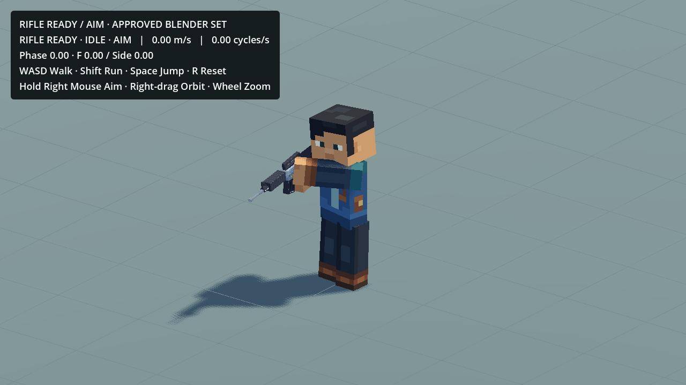
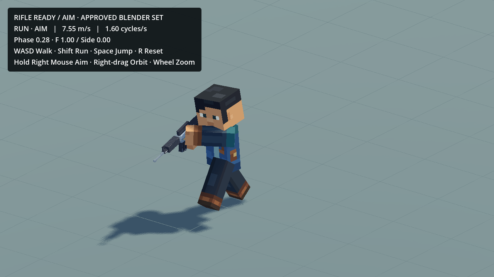

# Approved Rifle Aim — existing Godot research gameplay

User approval:2026-10-19. `Crossbow_Aim_ActionsStuff_Refined_Test_v001` is **Approved** in the existing Animation Showcase. Source Action, timing and Blender file remain unchanged. The previous Pending notes describe earlier authoring states.

Open `game_mobile_3d/scenes/dev/ActionsStuffWalkRunTest.tscn` in the existing Godot project; **F6** runs this same research scene. WASD Walk; Shift Run; Space Jump; R Reset; **hold right mouse Aim / release Ready**; right-drag Orbit; wheel Zoom. Focus loss releases Aim. No other scene, project, animation candidate, production WorldMap, Fire or Recoil was created or modified.

## Motion and integration

`rifle_ready_v001/aim_approved_library.res` contains the complete evaluated13-bone position, quaternion and scale data, plus the animated left-palm support point:865samples over3.6s at240Hz. `aim_profile.json` pins the exact Action/source/model hashes. It uses the actual unchanged Rifle Stylized V2 and existing skeleton/socket/render presenter. The original Ready `approved_library.res` and `profile.json` remain byte-exact.

Aim layers Spine, Chest, Neck, Head, both complete arms/ForeArm helpers and WeaponCarrier over Ready. After the2026-10-20 standing stability correction, Hips/root/legs and movement phase all remain in the existing Idle/gait system. Aim no longer replaces stationary Hips: its independent pelvis clock had conflicted with Ready Idle leg compensation and caused harsh fore/aft leg rocking. The approved source resource is unchanged; this is a runtime upper-body mask correction. During Jump/Landing the existing controller keeps core/Chest/leg compression and physics, while the Aim arms and head stay relative to the animated Chest. Head compression/scale remains owned by the jump layer. This is an upper-body gameplay adaptation, not full-body playback or a new Blender animation. Releasing Aim returns the original approved Ready arm/gun sway.

The first integration exposed a source-to-source arm-frame mismatch: the right arm needed only45deg of shoulder swing but quaternion blending also introduced approximately180deg of longitudinal roll; the left arm had the same problem. After the user's gameplay feedback, the runtime now represents both rectangular rigid Aim arms in an equivalent180deg local-Y frame before blending. Shoulder origins, long axes, palm positions and the complete occupied rectangular volume are unchanged; face/UV orientation uses the Ready-compatible roll frame rather than the source bone quaternion. The rifle Carrier is unchanged and its relative attachment is recomputed. This explicit retargeting adapter removes the corkscrew without modifying the approved Blender Action or inventing new animation keys. At full Aim, non-arm upper-body targets and actual rifle placement still use the raw approved source transforms. Maximum Ready-to-Aim arm rotation is now78.93deg across both arms rather than179deg; rapid input checks peak at12.43deg/frame at30FPS and6.24deg/frame at60FPS.

Ready↔Aim uses a reversible0.24s blend with no movement/input gate. The target clock continues through short input reversals, so there is no repeated reset to the first pose. The complete Ready/Aim arm-relative rifle attachment and live support target are blended, then reconciled after pose evaluation and at intermediate rendered poses. The weapon and hands share one displayed skeleton pose. The source's straight arms,7deg authored head lean, relative timing and subtle breathing remain; no generic firing/aiming pose replaces them.

The latest request explicitly names Walk2.70m/s and Run7.55m/s. The scene uses2.70/7.5465m/s (HUD rounds to7.55), normal1x animation, acceleration40/deceleration35m/s². This overrides the earlier accepted1.25x travel calibration (2.25/6.28875). Camera implementation/angle/distance/dead zone, jump physics, direction response and existing controls remain unchanged. RMB also retains the existing orbit gesture; aiming follows the character's locomotion heading, with no new cursor targeting or aim slowdown.

## Checks

`validation.json` records Blender export parity,30/60FPS Aim/Ready transitions and contact tests, camera comfort, render presentation, native Metal gameplay and preservation. Actual native gameplay shows Aim while Idle/Walk/Run, real capsule takeoff/landing, release to Ready and circular direction changes. Internal capture uses a closer front three-quarter review angle only; the saved/default gameplay camera remains unchanged.

The exact source has inherited rigid-cube contact limitations documented in its Blender study; integration does not claim optical ADS calibration or a completely collision-free production fit. It preserves that approved visual pose rather than redesigning its grips. Runtime numerical palm/grip checks validate the authored contact references, not finger anatomy or universal geometry collision avoidance. This is research-only, not commercial production permission. The already-enabled `actions_stuff_research_guard` excludes the whole research directory and this scene from normal exports.





## Rebuild without changing approved sources

From the repository root, use an external stage. Substitute installed executable paths on macOS/Windows:

```sh
blender --background --disable-autoexec --python game_mobile_3d/scenes/dev/actions_stuff_research/rifle_ready_v001/export_aim.py -- --stage /absolute/external/stage
godot --headless --audio-driver Dummy --path game_mobile_3d --script res://scenes/dev/actions_stuff_research/rifle_ready_v001/build_aim_library.gd -- /absolute/external/stage
```

This only rebuilds the separate Aim runtime resource/profile; it never rewrites the Ready library or approved Blender files. Raw sample tables, temporary exports and internal movies stay outside Git. The compressed Aim resource is about300KiB, ordinary Git; existing Showcase *.blend LFS tracking is reused for approval metadata. No LFS migration/history rewrite/force-push; account quota was unavailable. Existing source/approved runtime recovery remains in Git and the recorded baseline backups.
