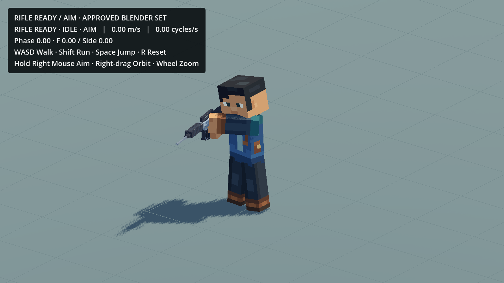

# Standing Rifle Aim lower-body stability —2026-10-20

Fixed in the existing `res://scenes/dev/ActionsStuffWalkRunTest.tscn`, through its private rifle visual script. No new animation, project or scene.

The Aim layer was replacing stationary Hips with the3.6s approved Aim sample, while legs retained the10.8s Ready Idle sample. Those leg curves compensate their own pelvis motion. Pairing them with a different pelvis produced up to3.03deg of unintended fore/aft leg tilt and59.8mm single-tick leg-root motion in the diagnostic. The targeted24s repro with Aim flicker measured2.81deg/43.47mm and failed before the fix.

Aim now remains strictly upper body (Spine, Chest, Neck, Head, rigid arms/ForeArm helpers, Carrier). Hips stays with the existing coherent Idle/gait leg set, including approved breathing/weight shift and the preceding low-clearance foot-release fix. No lower-body freezing, new smoothing delay, generic procedural pose or source key edit was introduced. This deliberately changes the runtime mask: the Aim resource still retains its complete exported pelvis/leg channels, but they do not override locomotion. Upper-body local Aim targets,7deg head lean, arm-frame correction, rifle attachment and support are unchanged. Body-level breathing now comes from the existing Ready/locomotion pelvis rather than an independent Aim pelvis.

The24s regression covers standing Aim, repeated short RMB reversals and return to Ready at30/60FPS. Unwanted fore/aft foot tilt is below0.000006deg; peak root step is14.47/11.69mm, belonging to the retained Idle weight shift. Planted soles stay stable and feet remain above the floor. Existing Aim Walk/Run, direction, Jump/Landing, grip/render contacts and camera tests, plus the previous Idle contact regression, pass at30/60FPS. Native Metal playback over more than one full Idle cycle was inspected. The internal capture uses a closer front three-quarter review view; the saved/default camera remains unchanged.

`validation.json` records the failing reproduction, final six checks and preservation. All approved Blender sources/Showcase, animation libraries/profiles, weapon presenter, actor, scene resource, camera and project settings remain byte-exact. Movement stays2.70/~7.55m/s with1x animation. Research-only/export-excluded; WorldMap and production assets remain untouched.

F6 the same scene; hold RMB to Aim. Stand for several cycles, toggle Aim, or release movement into Aim to compare. Raw diagnostics/captures stay outside Git.
