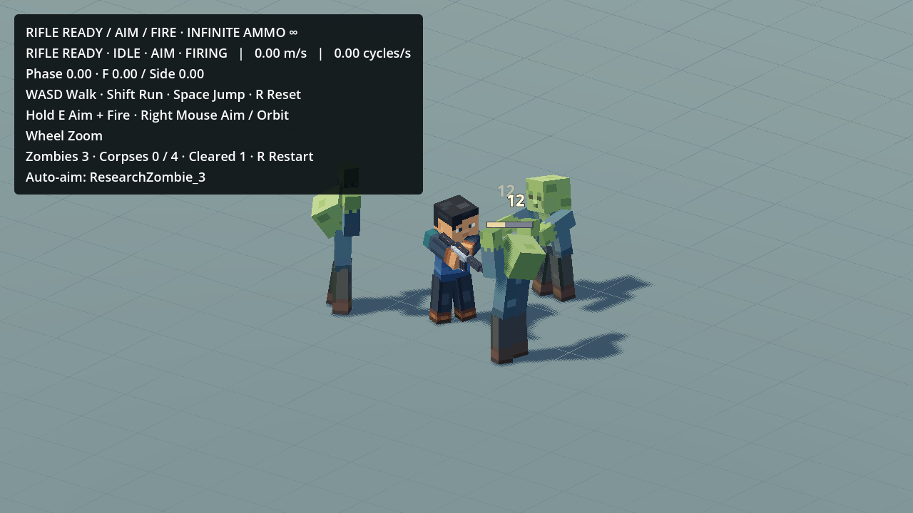
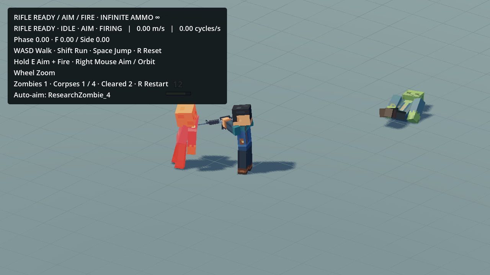
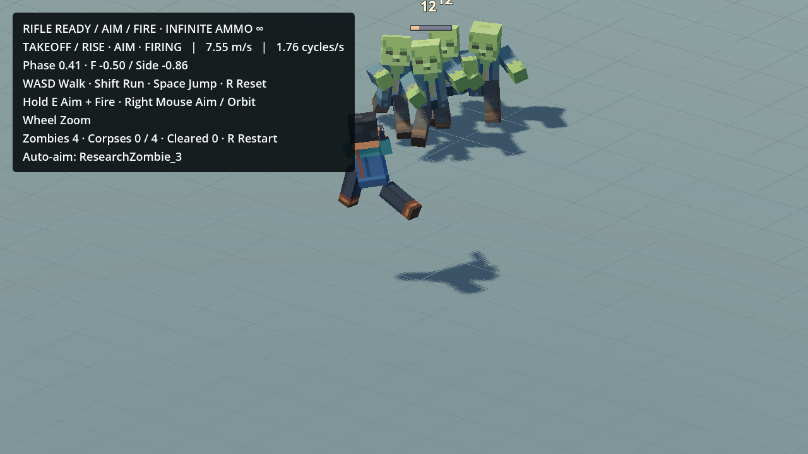

# Nearest-zombie auto-aim + wider camera

The existing `res://scenes/dev/ActionsStuffWalkRunTest.tscn` now automatically aims at the nearest living unobstructed zombie while **E** or **RMB** holds Aim. E raises the weapon and fires continuously at the existing6Hz; RMB remains aim/orbit only. Release restores normal movement facing. WASD/Shift/Space, R, infinite ammo and no reload remain. WorldMap, project settings, Blender Showcases and all approved animation resources are unchanged.

## Targeting and pose

The small adapter reuses the encounter's existing fixed zombie registry and the production AutoPistol's planar nearest-target policy. It scans at physics rate only while Aim is requested, within the existing rifle15m range, using one reusable ray query and the existing collision layers. Dead/queued corpses are skipped; terrain/other blockers prevent target selection. No per-frame group-array allocation or new combat/projectile system.

When several attacking zombies are almost equally near, retain the current visible target within a20cm margin of the closest to prevent rapid heading changes and stalled fire. A meaningfully closer target, death, lost visibility or range switches immediately on the next physics tick. This small spatial tolerance has no acquisition timer/input delay.

The existing angular facing speed turns the body toward the target without changing WASD travel, gait phase or physical jump. A bounded60deg common Spine correction aims the actual offset rifle ray at the target while carrying torso/head/arms/rifle together. It accounts for muzzle offset/weapon length rather than steering invisible bullets. Original relative grip/support/head lean remain; the source Action curves are untouched. Compute tracking from the clean Aim pose before recoil, then carry the **complete approved recoil** under that frame. Restore the prefix before the next pose evaluation so it cannot accumulate. Blend acquisition/release at20/s. Stationary turning releases obsolete foot anchors; existing contact logic replants afterward. This is a gameplay targeting adapter, not a newly discovered Actions & Stuff controller.

The rifle still launches ordinary pooled projectiles along the actual muzzle barrel. A selected target must be aligned within approximately2.56deg before a shot; large target switches therefore include a short physical turn. No homing, hidden bullet redirection, fire-rate increase or shot backlog. Without a selected target the prior manual firing behavior remains. Extremely close/inside-weapon targets, general terrain and new enemy rigs are not exhaustively validated.

## Camera

The requested farther view changes orthographic size **5.1→7.2** (about41% more world height visible) and actual camera distance **8→10m**. Increasing distance alone does not zoom an orthographic camera, so both are adjusted. Preserve the existing angle.66/.40rad, X/Z follow12/s, airborne vertical dead zone1.4/1.1m and damped8/s elevation recovery. No jump-follow bob, recoil shake, altered jump physics, new scene or production camera change.

## Verification

- `auto30.json` / `auto60.json`: nearest target at any bearing, real barrel alignment,20cm stability, meaningful closer-target switch, visible-dead-corpse rejection, obstruction/range, release/reset, actual in-range projectile kills and all four approaching zombies defeated. Responsive run/jump and both hand contacts retain submicrometre error; jump cameraY span under2mm.
- Existing Rifle Fire60FPS regression:159shots, pool misses0, unchanged lower-body poses and zero recoil residue. Original zombie damage/native handoff/1.20s cleanup suite remains passing with auto-aim explicitly disabled to isolate its pre-existing manual-barrel fixture. Camera comfort30/60 checks now expect the user-requested7.2/10m framing while retaining stability/long-fall checks.
- Native original-speed30FPS Godot capture (`native_gameplay.json`): all four automatic targets,5corpses cleaned across R reset,44shots, minimum display-quantized spacing1/6s, no pool misses, running plus one physical jump/landing. Camera distance10m/size7.2, jumpY span0.605mm. This is desktop correctness/visual evidence, not mobile performance certification.
- `preservation.json`:7,337 earlier Blender/Godot files checked. Only the three dev runtime adapters and two matching regression fixtures changed; no assets, source/approved animation resources, original native death physics, project settings or WorldMap changed. New targeting/tests are entirely under the existing export-excluded research root. Existing accepted baselines remain available.





Full movie/raw diagnostic probes stay outside Git at the local `experiments/rifle_autoaim_20261020` workspace. No new animation candidate, Blender review stage or commercial source reuse is implied.

Re-run from the existing project with Godot executable as available on macOS/Windows:

```sh
godot --headless --audio-driver Dummy --path game_mobile_3d --fixed-fps 60 --script res://scenes/dev/actions_stuff_research/tests/test_rifle_auto_aim.gd -- --silent-review
godot --headless --audio-driver Dummy --path game_mobile_3d --script res://scenes/dev/actions_stuff_research/tests/test_camera_comfort.gd -- --silent-review
```

Use30 instead of60 for lower display scheduling; physics remains60Hz. `RIFLE_AUTO_AIM_RESULTS` optionally selects a JSON output path. Normal user play launches use audio, without Dummy/silent flags. `auto_aim_enabled=false` reversibly restores manual targeting in this same scene.
