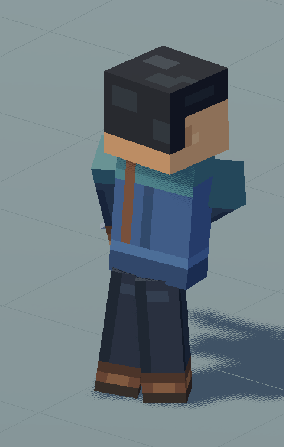
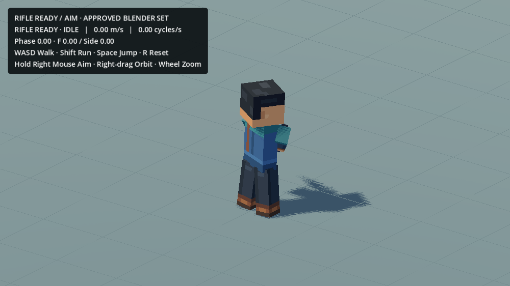

# Rifle Idle contact correction —2026-10-20

Fixed only the current research runtime in the existing `game_mobile_3d/scenes/dev/ActionsStuffWalkRunTest.tscn`. No Blender Action, Showcase, animation library, production WorldMap, movement tuning, camera or weapon pose was changed.

The approved Rifle Ready Idle has a low-clearance lateral foot reposition during its weight shift. The runtime previously released a planted foot only after its lowest corner rose35mm. The authored foot moved laterally without reaching that height, so the contact solver held its obsolete world anchor and translated the rigid leg root inward. Reproduction measured117.27mm of horizontal joint drag and110.62mm of negative projected clearance across the top100mm of the two legs.

The rifle visual now caches the already sampled current/future raw Idle poses. When fully settled on the ground, the foot is free while its authored planar sole-center speed exceeds0.025m/s; it replants when lateral motion settles and the existing floor/descending conditions allow it. This adds no input delay, animation keys, procedural replacement gait, limb bend or blanket stance widening. Contact intent is measured before Aim's hip overlay so raising the rifle alone does not release both feet. Walk/Run, transitions and airborne/landing use their existing paths.

The regression reproduces initial Idle, a Walk stop, more than two Idle cycles and Ready/Aim changes at30/60FPS. Maximum Ready Idle joint drag falls to10.78/16.09mm; projected upper-leg clearance stays positive (1.30/0.92mm). Supported sole motion stays below0.0005mm per tick; minimum floor height is floating-point zero. This clearance metric covers the top100mm of the two rigid leg boxes in the character's lateral axis, not a universal whole-character collision guarantee. Existing Ready and Aim30/60FPS transition/grip/camera checks also pass. `validation.json` records the original failing regression and all final results.

The approved breathing, look-around, weight shift, arm/gun sway and Aim roll correction remain active. Existing source and runtime resources remain byte-exact; only `rifle_visual.gd` changed among the protected runtime files. A new regression is in `scenes/dev/actions_stuff_research/tests/test_rifle_idle_contacts.gd`. Raw diagnostics and internal captures stay outside Git. This remains research-only and export-excluded.

Run the same scene with F6; WASD Walk, Shift Run, Space Jump, hold RMB Aim, R Reset. Watch the right foot during the Idle weight shift and after releasing movement.
