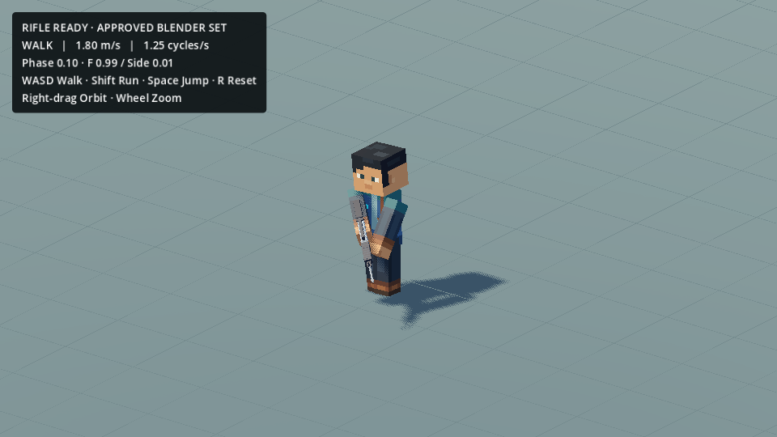
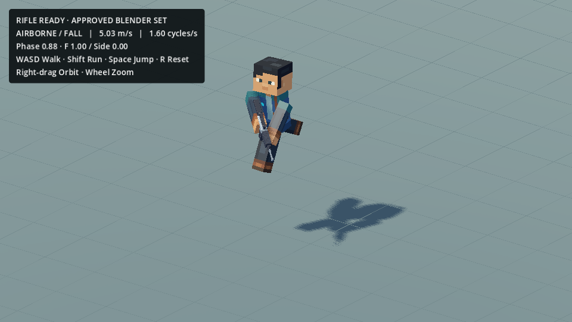

# Rifle Ready gameplay integration — 2026-10-17

The user approved `Rifle_Ready_Idle_ActionsStyle_v004`, `Rifle_Ready_Walk_ActionsStyle_v001`, and `Rifle_Ready_Run_ActionsStyle_v001` and authorized direct integration into the existing dev flow. All three are registered Approved. Historical Pending/no-Godot records are superseded for this set only; the source-derived handling remains research-only.

Play the existing `game_mobile_3d/scenes/dev/ActionsStuffWalkRunTest.tscn` with F6. WASD walks, Shift runs, Space jumps, R resets, right-drag orbits, and the wheel zooms. The scene now defaults to Rifle Ready; its `rifle_ready = false` option retains the previous unarmed baseline without a new scene. No WorldMap, project settings, approved source Action curves, source Blender review files or Rifle V2 source asset changed.

## Evidence

| Check | Result |
| --- | --- |
| Independently sampled Blender → Godot parity, 33 poses | Maximum local transform error 7.51e-6; actual rifle-root error 1.51e-6 |
| 30/60 FPS live input, rapid turns, reversal, Walk/Run/Idle, jump/land | Passed; contact/support error below 0.004 mm |
| Foot floor and ordinary-jump camera height | Minimum sole −0.000000060 m; camera height range 0 m |
| Render presentation endpoint/contact guard | Exact endpoint error 0; planted drift below 0.0005 mm |
| Existing research regression suite | 18 checks passed; old unarmed tests explicitly select the preserved unarmed mode |
| Native Metal/Mobile renderer capture | Actual scene, 30 FPS, one physics takeoff and collision landing; rifle visible |
| Protected research, weapon, WorldMap and project-file hashes | See `preservation.json` |

Compact machine-readable evidence is saved beside this note. Raw AVI captures, export tables and temporary fixtures remain outside Git. Screenshots below are actual Godot rendering of the existing scene, not Blender previews.

## Blending and scope

The complete approved evaluated PRS clips and original Rifle V2 mount are used. Idle/locomotion blends over 0.14 s; Walk/Run shares cumulative gait phase through the existing controller. The moving left support target is retained, and grip correction runs after pose blending and on intermediate rendered poses. This prevents crossfade separation without removing the subtle support-side life.

During Walk/Run crossfades the internally baked bob clocks briefly time-warp with the shared gait phase. Steady-state clips retain the approved timings; the full source crossbow controller VM was not added. Jump uses the already-approved core/legs with ready arms relative to Chest, rather than a new Rifle Jump animation. Existing responsive input, speeds, physics and comfortable camera are retained. Rifle Aim/Hold is deferred until gameplay feedback; no aim/fire/reload system was introduced.

Rebuild instructions and implementation: `game_mobile_3d/scenes/dev/actions_stuff_research/rifle_ready_v001/README.md` from the repository root. This directory remains covered by the existing research export exclusion.
