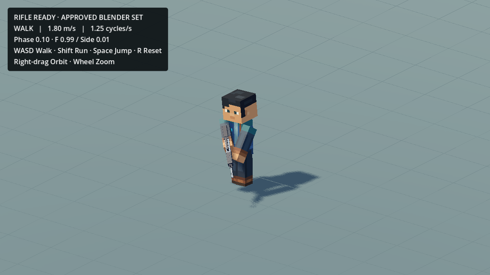
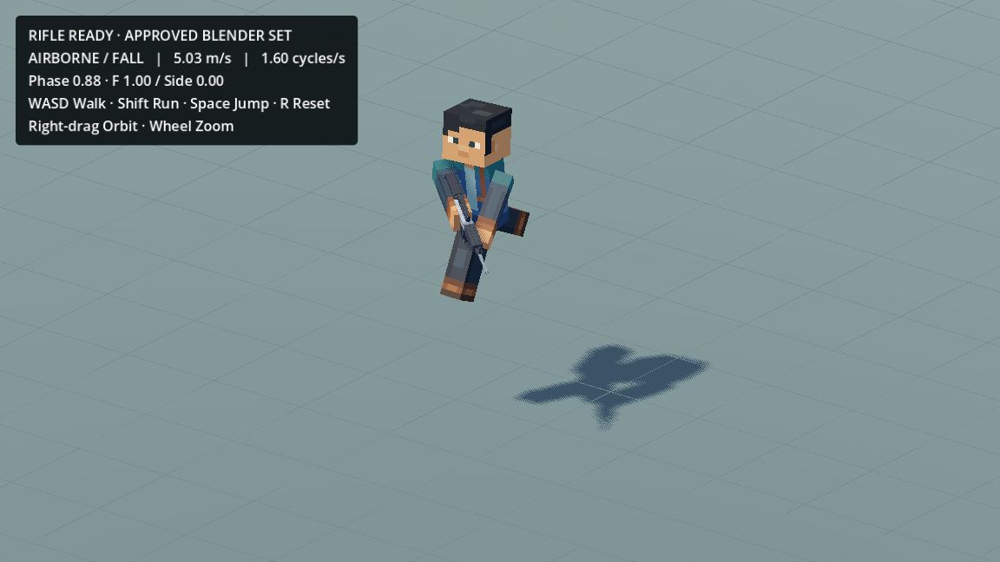

**2026-10-18 — latest user tuning: animation1× / travel1.25×:** User found the accelerated rifle gait less natural. The SAME `ActionsStuffWalkRunTest` now defaults to `locomotion_animation_multiplier=1.0` and `movement_speed_multiplier=1.25`: normal Walk1.25Hz / Run1.60Hz, travel2.25/6.28875m/s, acceleration40/deceleration35m/s². This supersedes the earlier1.5× playback/travel preferences. Approved hand/shoulder/gun-sway data, Blender Actions/Showcase, Idle, camera and jump physics are unchanged. The optional retiming adapter remains reversible but is bypassed at1×. Actual movement/cadence, Idle/jump and rifle contacts/transitions pass at30/60FPS. No new Action, project/scene or production change.

**2026-10-18 — Rifle Walk/Run animation playback 1.5× (user requested):** In the SAME `ActionsStuffWalkRunTest`, `locomotion_animation_multiplier=1.5` now retimes the shared rifle gait/clip cursor. Actual Walk cadence1.875Hz / Run2.40Hz matches the already approved1.5× travel (2.70/7.5465m/s); travel is not multiplied again. Approved poses, shoulder placement, support life and gun-sway amplitudes/relative timing remain in the same immutable library/source Actions. Idle/lifetime, input/filter/blend clocks, physics and camera stay real-time. Ground phase seeds the existing jump bridge before takeoff; jump layers retain original timing and authored phase overrides. 30/60FPS measured phase/actual travel/contact/transition checks plus native30FPS gameplay capture pass. No new Action/scene/project, production or Blender change. This supersedes the previous note preserving original gameplay locomotion cadence only; immutable source timing remains unchanged.

User follow-up, 2026-10-18: planar movement is now **1.5×**: Walk2.70m/s and Run7.5465m/s; acceleration48/deceleration42m/s². Walk/Run query thresholds are calibrated accordingly, preserving animation state/cadence. Actions/Idle/camera/jump constants remain unchanged. Fast30FPS takeoff floor-flag handling is corrected; actual jump/landing and travel/state checks pass at30/60FPS. The earlier integration measurements below describe the pre-speed-update baseline.

# Approved rifle Walk/Run sway — existing gameplay update

2026-10-18. The user approved the latest Blender results and requested immediate integration. Research-only, not eligible for commercial exports. No new scene/project/candidate.

Open `res://scenes/dev/ActionsStuffWalkRunTest.tscn` in the existing `game_mobile_3d` project, **F6**. **WASD** walk, **Shift** run, **Space** jump, **R** reset; right-drag orbit, wheel zoom. F5/main WorldMap is unchanged.

- Idle: unchanged `Rifle_Ready_Idle_ActionsStyle_v004`, 10.8 s.
- Walk: approved `Rifle_Ready_Walk_ActionsStyle_v0012`, 7.2 s full clock / 0.8 s gait; ±3° Chest sway, 60 ms holding response.
- Run: approved `Rifle_Ready_Run_ActionsStyle_v002`, 90 s full clock / 0.625 s gait; ±9° Chest sway, 40 ms holding response and latest Walking-matched shoulder placement. Source is `walk_matched_shoulders/run_walk_matched_shoulders.blend` (Action SHA `433d33c3b73c9f5aedd0420b2ab27123521270d22373c83fedae464717d9e76b`).

The existing evaluated PRS pipeline preserves source leg scale, core bounce, head behavior, both straight arms, actual Rifle Stylized V2 and ~1.55 mm support-side life. Each clip is exported from its own manifest-pinned source; older same-named Actions elsewhere are never substituted. Showcase approval metadata updated; source curves/files unchanged.

A regression with the new Blender poses measured the old fixed-rest support solve changing the moving left-arm transform by 0.0413; preserving the authored moving shoulder reduces this to <0.0000007. Render blends use the interpolated movement weight. Accepted Idle contact behavior is retained, and all 103,720 Idle track keys/times/values are exactly equal after saving/reloading the resource.

30/60 FPS checks pass: right-grip transform error <0.0000026; left-support error <0.006 mm; ordinary jump camera-height span 0; no extreme leg resets/floor penetration. 33 independent Blender fixtures pass PRS/rifle placement parity. Existing direction, jump, camera and render-presentation regressions pass. The native Metal capture exercised actual physics, one jump/ground landing and 240 frames at 30 FPS; screenshots below are from that scene. These checks do not claim phone performance or eliminate the inherited gait-phase crossfade clock adaptation.

Existing responsive movement, phase sharing, ~0.14 s Idle blend, Walk/Run controller blend, jump/landing core/legs, speeds 1.8/5.031 m/s and comfortable camera are unchanged. Jump carries the approved arm set relative to the existing Chest; no new rifle Jump Action. Previous runtime library/profile/scripts and their checksums remain together under `game_mobile_3d/scenes/dev/actions_stuff_research/rifle_ready_v001/backups/2026-10-18_before_sway/`; prior source studies/Showcases are preserved. `rifle_ready=false` still selects unarmed research.

Raw export tables and AVI capture stay outside Git in the task workspace. The required compressed runtime resource and its retained backup are each ~10 MiB, below the ordinary-Git 25 MiB warning threshold; no new LFS pattern, tracking migration, history rewrite or push. Existing dev export exclusions still apply.

See `validation.json` for machine-readable evidence and the existing runtime README for rebuilding.
