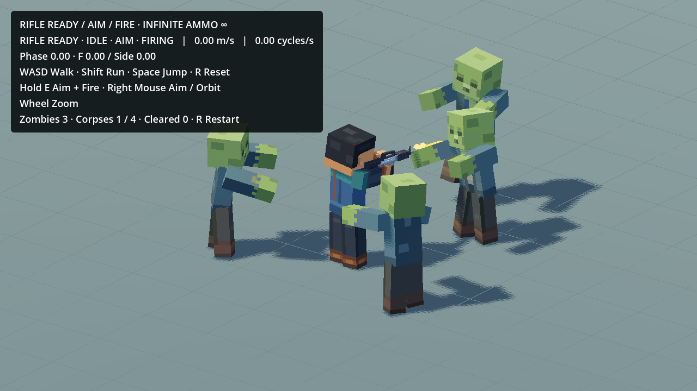
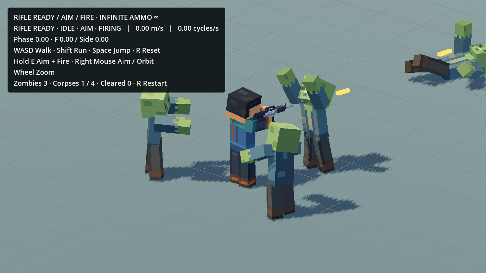
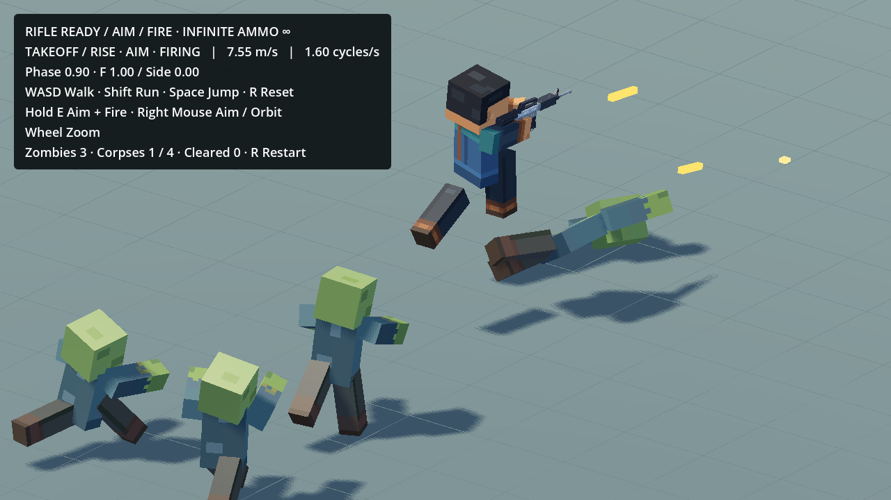

# Rifle zombie combat in the existing research scene

Open `res://scenes/dev/ActionsStuffWalkRunTest.tscn` in the existing `game_mobile_3d` project and run F6. F5 still opens WorldMap. Hold **E** to raise Aim and fire continuously at6Hz; WASD turns/moves, Shift runs, Space jumps, RMB aims/orbits, wheel zooms. **R** resets player, projectiles and the four-zombie group. There are no automatic waves.

## Reuse and boundaries

The original `CuboidZombie.tscn` provides the existing character/atlas, capsule, chase/stand-off AI, health60,12damage-per-rifle-hit, knockback, health bar and damage feedback. Existing rifle swept projectiles already call `take_damage(amount,direction)`: that component was preserved byte-for-byte. Existing bounded combat audio supplies shot/impact/zombie hit/death sounds. Zombie AI performs visual attacks with damage0; this study does not introduce player-health/death gameplay into the approved locomotion scene.

The adapter subclasses that actor and replaces only its old scripted death with the **unchanged** Lab `ragdoll.gd`, `physical_part.gd`, `death_profile.gd` and `presets/rifle.tres`. It retains seven rigid parts, six limited joints, inherited world motion, weighted single-event360N·s hit direction plus180N·s up and2.5N·m·s torque, explicit angular resistance and ground-only CCD. Nonlethal world knockback is existing behavior. The actual animated pose is sampled on the physics clock; AnimationPlayer is paused without RESET/model-offset rewinding on lethal handoff. Dead actors reject further damage, stop AI/pose writes and disable their capsule. Dormant ragdoll colliders are disabled while alive, avoiding collision with their own capsule.

The fixed group admits at most four active ragdolls/28native bodies/24joints. At **1.20 simulation seconds** the complete graph and corpse actor are freed. Unlike the lab's adjustable landing extension/pool, this fixed flat-ground encounter has a strict lifetime, no extra airborne wait/fade/frozen pose or retained physics. It captures the most important fall/impact; extremely high or long falls can be removed before finishing. R releases old graphs synchronously before creating another fixed group. Ordinary firing/deaths spawn no additional enemies. Existing damage-number feedback retains its original brief lifetime.

Gameplay keeps60Hz physics and all player inputs/speeds/animation/camera. This scene's World3D uses48 solver iterations for contact at60Hz; the standalone lab uses32 at120Hz. Original World3D solver settings are restored on exit (reference-counted for shared-world test fixtures). The floor remains atY0, with the Lab's.4m contact slab/.6solver bias under it. No project setting or production script/scene changed.

## Exact requested Mobs animations

The user specifically requested these three existing entries from `Mobs_Animation_Library.blend` during integration:

| Action | Timing | Preserved saved status |
|---|---|---|
| `Zombie_Idle_ActionsStuff_Source_Test_v001` |3.6s loop|Pending|
| `Zombie_Walk_ActionsStuff_Source_Test_v001` |18s layered loop,0.75s stride|Pending|
| `Zombie_Attack_Player_A&S_Reference_v001` |0.75s one-shot, exact fractional endpoint|Reference Only|

`zombie_combat/export_mobs.py` reads the saved source and native Action slots, never saves Blender. It exports every authored dense sample/key, full evaluated position/quaternion/scale, with root basis converted to Godot. Original10native bones bind to the existing model; the unskinned `Reference_RightItem` helper is omitted. No source bone, mesh, texture or rest-rig changes. The compressed library is approximately1.6MiB, below ordinary-Git25MiB warning threshold; no LFS/tracking changes.

These are the existing chosen adult/source-state studies, not the complete Minecraft controller VM. The source Idle/Walk already bake layered sway/posture; Attack already bakes its chosen stationary/held-target/Idle preset. Full clocks/keyframes and asymmetries are retained. The game uses120ms Idle/Walk blending and60ms Attack entrance/100ms recovery around those clips; Walk preserves its clock through transitions. Fixed per-clip presentation floor offsets match the library's source review floor. No invented generic arm/leg cycle or Hurt skeleton animation is substituted. Existing world knockback and hurt tint remain. This integration is **research-only**; dev use does not promote saved review statuses or authorize commercial reuse.

Both Blender Showcases, all Actions and prior sources remain exact. The existing enabled export guard skips the whole `scenes/dev/actions_stuff_research/` directory and this dev scene on normal exports. WorldMap, production player/zombie/weapons and project configuration remain exact.

## Essential validation

- Real held-E swept projectile hits: five12damage shots kill60HP, one native handoff, correct directional impulse, real torso-ground contacts,1.20s cleanup and no surviving physical bodies/joints.
- Four simultaneous lethal hits: at most28physical bodies, all freed; reset mid-flight clears the previous graph and pending shots. Existing AI triggers requested source Walk and Attack.
- `combat30.json` / `combat60.json`:30/60 display scheduling with60Hz physics; finite bodies, contact/joint guards and preserved speeds. These sampled cases are not universal terrain/contact proofs.
- `source_parity.json`:24 Blender fixture poses, maximum translation deviation2.742µm from float32 timestamp quantization; quaternion dot error5.96e-8, scale error0. Loops and exact requested resource names verified.
- Existing Rifle Fire30/60 regressions pass:159shots, no pool misses, unchanged lower-body poses and zero recovered recoil residue. Grips remain within1µm of accepted contacts.
- Native original-speed30FPS Godot capture: real projectile deaths, source Walk/Attack, R reset, running fire, one physical jump/landing, cameraY span below1mm, no tracer pool misses. See `native_gameplay.json` and captured pixels. The movie readback/concurrent test monitor peak is retained as raw evidence and is **not** a performance benchmark.
- `desktop_burst.json`: an isolated short desktop four-death burst (no movie capture) measured9.128ms synchronous handoff for all four; sampled physics-process monitor peaks stayed below5.4ms and zero corpses remained. Monitor values repeat between updates and do not establish per-body scaling, mobile performance or long-session thermals.
- `preservation.json`:7,321 earlier Blender/Godot files checked; only the existing research coordinator changed. No missing files, both Showcases and production/project files exact. Accepted continuous-fire baseline is separately recorded.

Actual Godot pixels:





Source/action hashes and loop metadata are in `game_mobile_3d/scenes/dev/actions_stuff_research/zombie_combat/profile.json`. Raw bake tables, diagnostic probes and full native movies stay outside Git under the local `experiments/zombie_rifle_combat_20261020` workspace. This is a small flat-ground desktop study, not Android/iOS performance certification, slope/stair validation or final combat balance.

## Rebuild/check

Run from the repository root with installed Blender/Godot executable paths and an external writable stage:

```sh
blender --background --disable-autoexec --python game_mobile_3d/scenes/dev/actions_stuff_research/zombie_combat/export_mobs.py -- --repo /absolute/repository --stage /external/stage
godot --headless --audio-driver Dummy --path game_mobile_3d --script res://scenes/dev/actions_stuff_research/zombie_combat/build_library.gd -- /external/stage
godot --headless --audio-driver Dummy --path game_mobile_3d --script res://scenes/dev/actions_stuff_research/tests/test_zombie_source.gd -- /external/stage --silent-review
godot --headless --audio-driver Dummy --path game_mobile_3d --fixed-fps 60 --script res://scenes/dev/actions_stuff_research/tests/test_zombie_combat.gd -- --silent-review
```

Use30 instead of60 to exercise lower display scheduling. `ZOMBIE_COMBAT_RESULTS` optionally selects the output JSON. User play launches use normal audio, without Dummy/silent flags.
