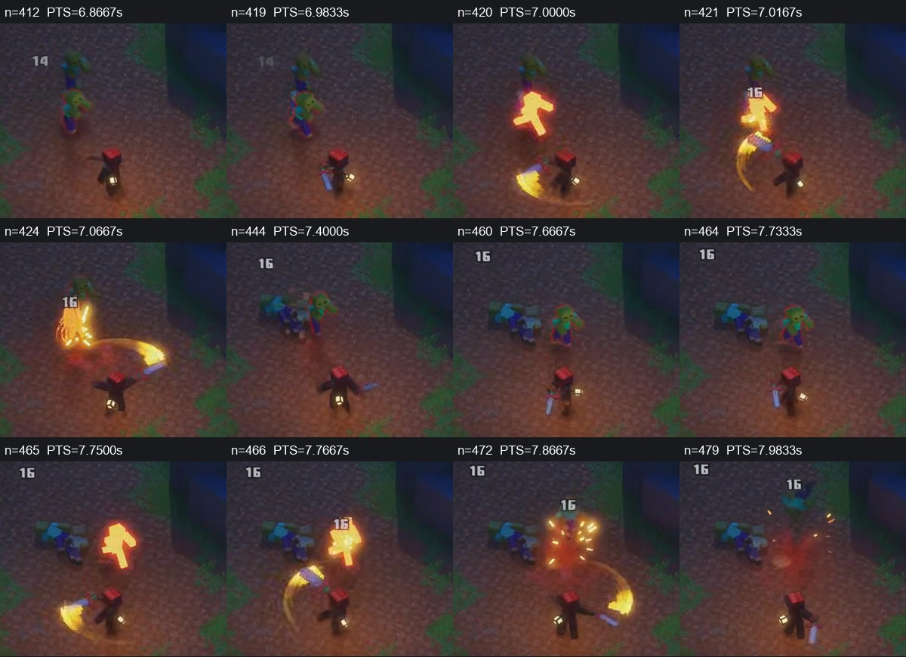
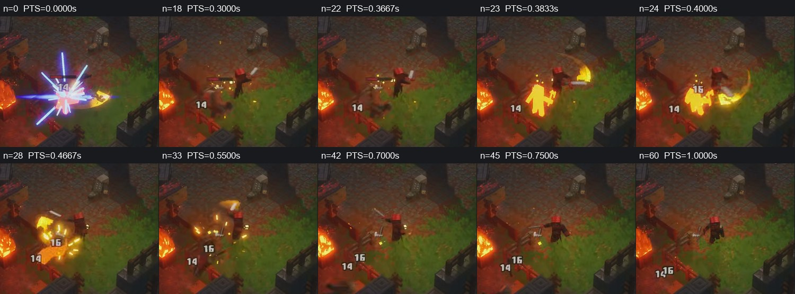
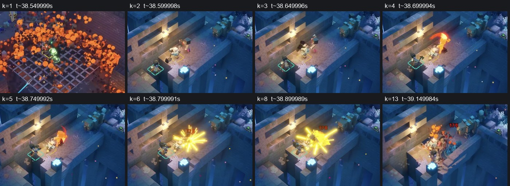
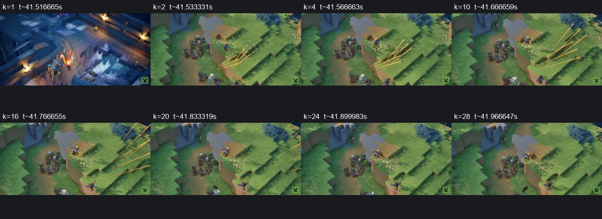
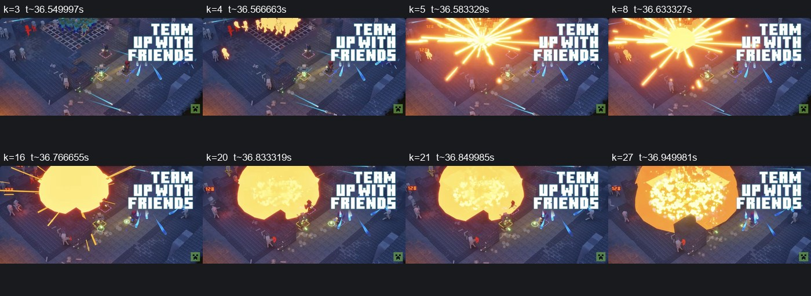

# MD2 frame-based combat observations

2026-10-25. **O** pixels/decoded metadata, **E** estimate, **P** proposal, **U** unknown. Main [research](MD2_COMBAT_ANIMATION_RESEARCH.md); machine-readable [evidence](md2_combat_phase2/evidence.json). “Observable impact” below means **visible target flash/contact-region burst**, never an inferred engine damage tick.

## Measurement method

V2=[XboxDynasty public video](https://www.youtube.com/watch?v=mgzk7uhAfjk). Existing two8s caches decode to480 frames each,1280×720,60/1FPS, timebase1/15360 with256PTS ticks per frame. All480PTS per clip were checked. Index **n starts at0**; exact local time=n/60. Source URL time≈150+n/60 or220+n/60, with at least one-frame source-offset uncertainty. Neither video FPS nor an encoded repeated pose proves game/animation FPS. Cache metadata records no local retime; original uploader playback speed/build remain independently uncalibrated.

V1=[official Minecraft trailer](https://www.youtube.com/watch?v=vBNE3bKMpu8). Public browser was paused at playbackRate1.0; keyboard steps advanced visible mediaTime by≈1/60s. **k is a local UI sample index**, not a global encoded-frame index. Cached older rendition metadata says60000/1001FPS; do not conflate those clocks. Browser timestamps have at least one presented-frame uncertainty. Heavy-case samples are3UI steps/≈50ms apart. Cuts and one screenshot layout anomaly(ranged k23, excluded) are recorded. Sheets are labelled crops/downscales for analysis; they are not untouched full-video frames.

Cached V2 clips contain **no audio stream**; browser playback was muted. No frame-synchronous SFX offset was measured. Sound alignment below is a future design recommendation only. Hashes, crop provenance, selected indices and limits are in evidence.json. Only small attributed public frame crops are retained as development research references, not production art. No full public video, extracted game asset or copied source curves are added.

## G01 / G02 — successive single-blade slashes

[Source at≈157s](https://www.youtube.com/watch?v=mgzk7uhAfjk&t=157s). The red-haired actor carries a straight blue blade; exact item ID is not shown. Calling it sword-shaped is a silhouette classification, not a verified weapon definition.

| Landmark | Cached n / exact PTS | Observable result |
|---|---|---|
| Pre-event pose |412 /6.866667s | Weapon/arm away from the later open sweep; full attack/input onset unknown. |
| Last frame before first flash |419 /6.983333s | Target not yet solid yellow. |
| First target flash |**420 /7.000000s** | Target becomes bright yellow and yellow blade trail is visible. |
| New numeral |421 /7.016667s | New16 appears one decoded frame later. |
| Sweep/follow-through |424–432 /7.066667–7.2s | Broad curved trail crosses beside actor; torso silhouette redirects with arm. |
| Low-guard/fall landmark |≈444 /7.4s | Weapon low; one zombie lies/finishes falling. Return estimate±4frames. |
| Last frame before next flash |464 /7.733333s | Next target not yet bright yellow. |
| Next target flash / number |**465 /7.75s**,466 /7.766667s | New target flash again precedes numeral by1frame. |

**O:** flash-to-flash45frames=.75s. This is one visible inter-feedback interval, **not** weapon cooldown or proof of a three-hit combo. G02 recovery is right-censored by the8s cache boundary. The fallen target persists into the following strike; its fall does not identify ragdoll versus skeletal animation.

**E anatomy:** arm/blade turn together and body facing redirects; small feet, clothing and moving camera prevent reliable support, hip angle or compression measurement. No believable foot-load ratio or exact physical blade contact can be derived here. Strong feedback arrives while a full trail is still developing; damage cannot be scheduled from the numeral alone.

**P takeaway:** readable fast drive plus follow-through, one confirmed-hit feedback event, and a separate next-input policy. Preserve travel/foot ownership instead of adding a static planted lower body to moving combat.

## G03 — close melee, visible load-to-return landmarks

[Source at≈220.38s](https://www.youtube.com/watch?v=mgzk7uhAfjk&t=220s).

| Landmark | n / PTS | Scope |
|---|---|---|
| Prior contact |0 /0s | Bright effect14 already active: left-censored, no onset measurement. |
| Raised weapon pose |18 /.3s | Blade above/outside shoulder; a selected visible landmark, not attack start. |
| Last no-new-flash frame |22 /.366667s | Target not yet solid yellow for next hit. |
| First new target flash |**23 /.383333s** | New yellow silhouette and curved trail. |
| New16 numeral |24 /.4s | One decoded frame after flash. |
| Follow-through |28–33 /.466667–.55s | Arc continues; enemy tilts/drops. |
| Lowered weapon landmark |≈42 /.7s | Blade lowered; estimate±3frames, not proof controller is interruptible. |

**E ratio:** selected raised-pose→flash5frames versus flash→lowered-pose19frames = **5:19** (.0833:.3167s). This is a ratio between chosen visible landmarks, **not the complete anticipation/recovery ratio**. Recovery estimate and unknown onset prevent a precise full-action duration. The actor's upper body and blade sweep remain readable, but sparks/fire/occlusion prevent precise hips, feet and contact geometry. A generic animation-state diagram cannot be recovered from this sequence.

## T03 — heavy-looking square-headed melee candidate

[Official source≈38.6–39.45s](https://www.youtube.com/watch?v=vBNE3bKMpu8&t=38s).

Shot changes between k1≈38.549999 and k2≈38.599998. A white-headed actor and square-headed weapon silhouette appear near the bridge; this is **E hammer-like**, not a named/verified hammer. An orange arc is visible by k4≈38.699994. Last sampled no-bright-burst k5≈38.749992; first sampled burst **k6≈38.799991**, giving a50ms bracket. By k8≈38.899989 a170 numeral is readable; dust/debris continues around k10–13.

**E:** arc-landmark→burst≈.10s, sampled coarsely; it is not full wind-up time. Initial stance/loading is censored by the edit. VFX and a narrow bridge obscure soles and clear torso landmarks. Attack power, item mass, root motion and exact enemy reaction onset are unknown. Do not call this a verified axe, hammer slam or damage frame. **P:** use preparation/receive contrast for a future heavy asset, then validate its real head arc and support.

## T02 — ranged fan already in flight after a cut

[Official source≈41.53–41.98s](https://www.youtube.com/watch?v=vBNE3bKMpu8&t=41s).

k1≈41.516665 is the preceding shot; **k2≈41.533331** is a new outdoor shot with projectile trails **already in flight**. This is an edit boundary, not a release frame. Multiple bright trajectories travel outwards; visibility from k2 through k20 spans at least.30s. Exact source weapon, charge, release, hit target and impact are unresolved; projectile speed cannot be converted to m/s without camera/world scale. k23 had a transient screenshot layout anomaly and is excluded.

The distant actor's arm/foot details cannot support a precise brace or compression analysis. No wind-up/recovery ratio is defensible. **P:** synchronize muzzle/hand pose and gameplay launch on one event, separate flight from reaction, and preserve GAF's approved6Hz rifle behavior rather than borrowing a montage shot's apparent cadence.

## T01 — special area-effect feedback

[Official source≈36.55–36.95s](https://www.youtube.com/watch?v=vBNE3bKMpu8&t=36s).

Last sampled no-group-flash k3≈36.549997; first bright affected silhouettes **k4≈36.566663**. Large starburst appears k5≈36.583329, then expands into a filled disc; by k21≈36.849985 the disc visibly breaks into particles. Selected silhouette-onset→breakup17UIsteps≈.283s. This is visual evolution, **not a damage-duration or animation-recovery measurement**.

Multiple players/projectiles are present; the responsible caster, preparation, input, skill identity, radius and final recovery are unknown. Feet, hips and arms are mostly hidden. The wide effect masks many next-pose cues. **P:** retain a clear directional/action silhouette before impact, make confirmation brief, and scale effects down for our mobile-first camera; do not reproduce the trailer's full-screen effects.

## Field coverage and what cannot be measured

| Requested field | Available evidence / limit |
|---|---|
| Initial stance, anticipation, compression | G03 raised pose observable; exact input onset/load minimum unknown. No metric compression. T02/T03 starts are cut. |
| Foot placement/support | Some lower-leg silhouettes visible; floor support, load and sliding cannot be reliably separated from camera motion/VFX. |
| Hip/torso rotation, arms/weapon | Qualitative facing/arc changes in G01–G03; no defensible bone angles or rig hierarchy. |
| Acceleration toward impact | Abrupt frame-to-frame arc/feedback changes observable; no calibrated 3D velocity/force. |
| Observable impact | G01n420, G02n465, G03n23 exact within their decoded caches; browser cases use bounded UI samples/censoring. |
| Follow-through/recovery | Arc continues after flashes; chosen low-guard landmarks are estimates. A low guard does not prove a cancel state. |
| Combo transitions / movement interruption | G01/G02 follow each other; no input trace. Cannot prove buffer, cancel permission, movement lock or hitstop. |
| Enemy reactions | Flash then body rotation/drop; exact damage/physics ownership unknown. |
| VFX / SFX | VFX ordering measured above; no frame-synchronous audio analyzed. |
| Daggers / axe | No confidently identified complete attacks in the reviewed unmodified references. Leave numeric timing unfilled. |

For future extensions, require: source URL/creator/build/mod status, uncut start→end, source PTS/FPS, exact frame-zero convention, pre-contact and post-contact neighbours, capture hashes, audio track/offset, occlusion notes and the uncertainty on each landmark. Preserve **unknown** rather than invent a complete phase chart.
