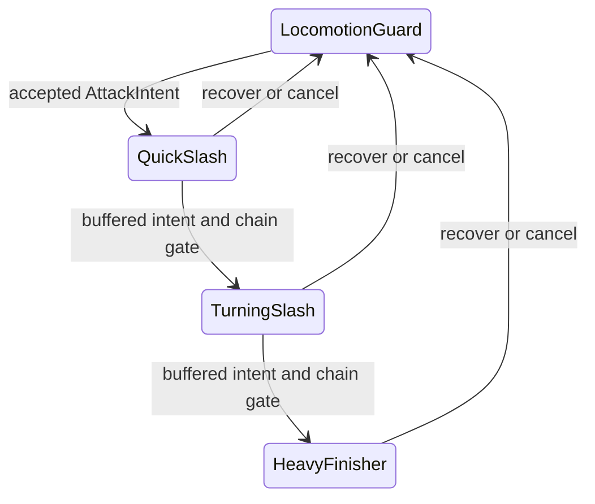

# Original melee framework and three-hit sword brief

**P — proposed original design, 2026-10-25. No Action/model/runtime implementation or artistic approval.** Informed by [A&S source principles](SOURCE_EVIDENCE.md#c01), [MD2 observations](MD2_COMBAT_FRAME_ANALYSES.md), and [documented UE responsibilities](MD2_COMBAT_ANIMATION_RESEARCH.md#unreal-engine-architecture-supported-technologies-not-md2-findings). None of the timings below is an MD2/A&S reconstruction.

## Contract before authoring

Select an actual original/licensed **one-handed sword**, handedness, grip, blade base/tip and reach. No melee asset is selected by the current Weapon Showcase; do not create a placeholder sword model under this research request. Measure swept clearance against head/hair/bandana, torso, rigid limbs and nearby geometry.

Author against the exact rest/slot contract compatible with the existing13-bone Animation Showcase. Keep technical Neck/ForeArm helpers, whole straight limbs, unit scale and current appearance. Soldier's standalone10-bone source is distinct; current runtime rebinds its appearance onto the existing Skeleton. Do not silently change either rig. Use [existing workflow](AUTHORING_WORKFLOW.md) and [rig constraints](RIG_CONSTRAINTS.md).

The first concept is grounded: **Quick Slash → Follow-up Turning Slash → Heavy Finisher**. Body articulation is in place. Capsule/controller owns world travel. No new key binding is assigned; current E/Q/C/Jump controls remain untouched. AttackIntent below is a future abstract input contract.

## One action cursor, explicit ownership

A future AttackDefinition records: stable ID/provenance, compatible rig/source/slot, duration/play rate, pose mask, required weapon markers, support landmarks, active interval, feedback events, combo accept/commit interval, allowed interrupts and exit pose/velocity. **An Action name, montage section or notify alone does not define gameplay.**

When stationary, support-aware full-body poses may own the transient receiving step. While moving, keep existing legs/root/gait clock authoritative and use a compatible upper action/limited torso contribution; release any stale planted contact before travel. A static lower-body attack blended onto translating feet would reintroduce skating. If one Action cannot support both contexts, report the incompatibility before adding variants. Jump physics remains immediate/authoritative; this grounded v1 cancels on accepted Jump rather than inventing an air attack.

Future melee must be an explicit branch in the existing composed pose pipeline. Rifle carry/Aim/recoil constraints yield only in the new weapon mode; inactive melee contributes zero. Restore previous event-relative offsets before the base and compose each delta once. Constrain attachment after blending; renderer interpolation must carry hands and sword together. No competing AnimationPlayer/AnimationTree writer and no perpetual additive drift.

## Original timing proposal

30FPS authoring, **F1=t0**; t=(F−1)/30. End frames are real nonloop endpoints, not an extra duplicate loop frame. Intervals are **[open,close)**. Contact is a planned blade/target pose, while actual damage requires valid collision during the active interval.

| Action | End / duration | Planned contact | Blade active | Combo accepts next intent | Earliest commit / last boundary |
|---|---|---|---|---|---|
| A1 Quick Slash |F16 /.500s |F7 /.200s |F6–F9 [.1667,.2667) |F9–F14 [.2667,.4333) |F13 /.400s; beforeF14 |
| A2 Turning Slash |F19 /.600s |F9 /.2667s |F8–F11 [.2333,.3333) |F11–F17 [.3333,.5333) |F16 /.500s; beforeF17 |
| A3 Heavy Finisher |F25 /.800s |F13 /.400s |F11–F15 [.3333,.4667) |No fourth attack |Recover to guard; no automatic loop |

Proposed contact-before:after ratios are **6:9**, **8:10**, **12:12** frame intervals, not copied source ratios. Fully early-buffered flow lasts≈1.70s to guard: contacts≈.20/.667/1.30s after A1 start, with A1/A2 committing at.40/.50s. Actual pose/grip/support review can change all proposed numbers.

## Attack 1 — Quick Slash

- **F1:** take current guard/support, right grip firm, blade near right-front body; left arm clears the intended path. Do not teleport to a wide stance.
- **F4:** small shoulder/chest counter-turn and connected load; gaze remains useful. Use reachable hip/rigid-leg attitude rather than limb scaling.
- **F6→F7:** accelerate whole right arm/sword through a descending diagonal from upper-right toward left-front. Left/front support receives; any small step must be completed or intentionally receiving, never a foot dragged by torso yaw.
- **F9:** blade passes beyond target, chest follows in a restrained opposing arc. Avoid stopping the weapon instantly at the target centre.
- **F11→F16:** reduce torso/arm excursion and return to guard. At F13, exit velocity/weapon position can feed A2 instead of resetting to neutral.

Footwork: one small reachable left receiving adjustment if starting support allows it; otherwise use current support and revise the arc. The full rigid sole/corners, not a dust effect, decide contact. **Feedback:** short whoosh/trail at drive, confirmed hit flash/impact at collision; a miss still has follow-through but no hit flash or impact sound.

## Attack 2 — Follow-up Turning Slash

- **F1:** inherit A1's actual outgoing blade position and velocity via a short compatible handoff. Do not mirror a neutral-start attack.
- **F5:** carry the blade through a compact left-side preparation; torso/hips reverse with a small receiving right-side adjustment. The free left arm counterbalances without crossing the face.
- **F8→F9:** release a controlled left-to-right turning sweep across the front. This is a torso/support redirection, **not a360° spin**. Physical facing still has one owner; do not rotate a planted sole beyond reach.
- **F11→F14:** blade clears the target; torso/shoulder follow at reduced amplitude.
- **F16→F19:** chain into A3's raised preparation if a valid intent remains; otherwise return to guard without changing the underlying gait phase.

Footwork: free/replant the receiving foot while retaining the opposite reachable contact; no compulsory extra steps after stopping. **Feedback:** a distinct but modest whoosh character; trail only around the fast sweep, impact only on actual hit. Do not trigger extra damage from the visual return arc.

## Attack 3 — Heavy Finisher

- **F1→F5:** continue from A2's outgoing weapon path into a braced guard. Let the pose prepare the viewer without locking movement input.
- **F9:** clear overhead/right preparation, connected hips/chest and a visible load through stance and torso pitch. Any body lowering is bounded by actual rigid-leg reach; no mandatory millimetre drop, rubber legs or exposed waist gap.
- **F11→F13:** fast descending diagonal, whole arm rigid, gaze following the target. The selected sword's actual length must clear hair/head through the full arc.
- **F15→F18:** receiving posture and restrained follow-through. Free hand counterbalances; one-handed design does not invent a second grip mid-swing.
- **F21→F25:** one small diminishing settle into guard. No repeated bounce, extra hop or idle leg oscillation.

Footwork: connected brace with an intentional receiving foot; width/drop are solved on the actual rig, not taken from trailer pixels. **Feedback:** fuller but short impact on confirmed contact, modest local particles and a readable blade stop-through. Global hitstop, camera shake and extra knockback are **off by default**; current stable camera and death-physics tuning remain untouched.

## Events, buffering and cancellation

All conventions below are **P future contracts**:

| Concern | Convention |
|---|---|
| Time | Physics-owned action seconds; authoring frames are converted once. Time0 start events dispatch explicitly. Then process discrete events over(prev,next], so a large tick cannot skip one. |
| Active interval | Sweep only the intersection of the physics step with[open,close), including a step that crosses both boundaries. Sample blade at those clipped times; do not leave a stale full-frame hitbox active. |
| Hit ownership | One hit per victim per attack instance. Preallocated victim-ID/generation storage prevents duplicate limbs/colliders damaging repeatedly; the next combo link gets a new instance ID. |
| Contact | Use the selected blade's base/tip/swept thickness and existing collision filters. Spatial broadphase then bounded sweeps, not a full100-enemy scan per blade point. Sampling budget must be measured on actual speed/reach. |
| Feedback | Separate Whoosh, TrailBegin/End and ConfirmedHit. Hit VFX/SFX/flash originate from collision; never use a cosmetic trail or damage numeral as authority. |
| Buffer | One pending new input edge, proposed TTL.18s. Accept during the listed combo window, or carry a still-valid early intent into it. Consume once at earliest commit or later valid boundary; expire stale inputs. Held-auto-melee is not assumed. |
| Chain | A1→A2→A3 may continue on hit or miss; no unrequested hit-confirm restriction. At commit, preserve current pose/velocity/support, cancel old unconsumed events and start the next instance. No recovery-to-neutral pause. |
| Interrupt | Death/severe stagger and accepted Jump abort the grounded action immediately. Ordinary movement remains responsive. Proposed defensive cancel becomes allowed after blade close when such controls exist; no new block/dodge input is installed now. |
| Cleanup | Every abort/end/switch closes active damage, ends trail, clears old events/target hits and releases obsolete support. Same-tick cancellation has priority over new damage. No canceled attack may damage later. |
| Repeated hit reaction | Reuse current bounded directional response/retrigger guard; do not reset locomotion or stack unlimited impulse. Lethal damage yields once to existing native death physics. |

VFX trail can appear on a miss because the blade moved; a damage flash/impact requires a real hit. Proposed whoosh cues lead the planned contact by one authoring frame, but final SFX offset needs actual licensed audio and normal-speed review. No MD2 audio offset was measured. Preserve current6Hz/infinite-ammo rifle; melee timing is independent.

## Review and future implementation checks

The existing Showcase remains the only central review destination. A later authorized task should start with **one** compatible original A1 Action, Pending, in a separate source study. Inspect actual selected sword, skin, source slot and full-pose reset; do not create all three now. Show normal-speed front/three-quarter/side and current wide-camera scale, then obtain artistic approval. Only authorized integration belongs in existing ActionsStuffWalkRunTest; no extra scene/project or WorldMap change.

Future30/60FPS checks: both support leads; stand/walk/run; rapid direction/taps; miss/one/many targets; buffered/late/expired input; dt crossing both hit boundaries; cancel just before/inside/after contact; jump mid-swing; weapon swap; dead target; no repeated death;100-enemy crowd and bounded effects. Compare final posed blade sweep and rendered hands/weapon, not isolated source tracks. Evaluate drift across repeats, foot corners, pose/velocity seams and allocations/CPU cost. Use fixed reusable queries/effect pools, bounded audio voices and no per-hit node creation. Full-body melee and physics must never compete over a corpse.

These are acceptance criteria for the **next implementation**, not tests claimed completed by this research. Current desktop running+rifle stress baseline still does not prove sustained110–120FPS or phone performance.
