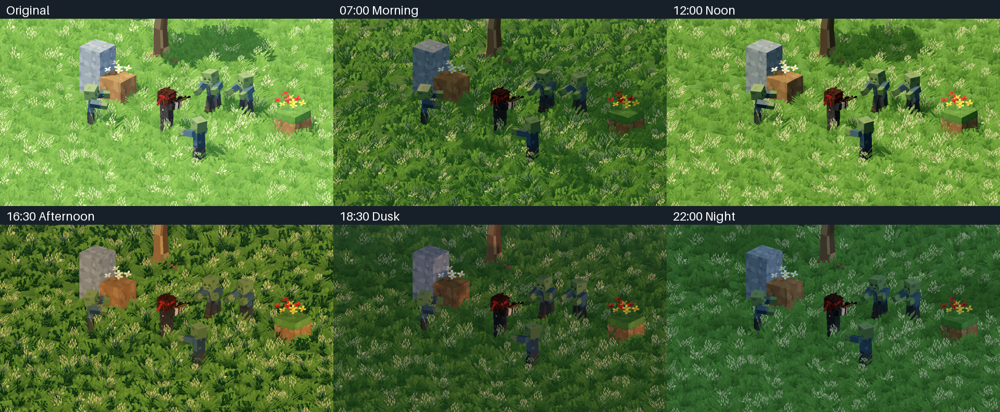

# GAF_MD2_Lighting_v001 — native Godot review

Existing `res://scenes/dev/ActionsStuffWalkRunTest.tscn`, Mobile4.7.2, Noon/Medium starts paused. **L**folds the compact panel. Five preset buttons, full time slider, Auto/Pause/cycle speed, Original A/B, quality and Fog/Glow toggles. Previous gameplay controls remain.

[10-second native transition](day_transition.mp4) · [Controls](06_controls.png) · [Overview/sky](07_overview.png) · [Research/source evidence](../../MD2_LIGHTING_AND_GRAPHICS_RESEARCH.md).

Comparison uses identical gameplay camera/pose/content/frozen wind phase. Existing stone/dirt/flower/tree links provide shadow/material checks. Video:300frames/30FPS/10seconds, actual actor/grass animation1×; time-of-day seeking is accelerated preview. Readbacks are not benchmark timings. Final capture logs are clean after warming native skin storage before reconnecting approved presenter callbacks.

20lighting contracts,29grass contracts, Fire30/60, Strafe and camera checks pass. Fresh review's twoImportant lifecycle/input findings have RED→GREEN fixes. All8,939pre-existing Blender/game files audited: only authorized lab script/scene and grass fragment grading changed; vertexbody exact. No Blender/WorldMap/projectdefault/approvedplayer/rifle/zombie edits.

[Raw performance](performance.json):300samples/tier with combat, run/jump, wind/passage. MacM2Pro/Metal/1280×720~60FPSmedian; phonespending. GPUN/Aon this backend; two-split shadowdrawcounterN/A, shadowprimitivesavailable. DeliberateRresetspike~64msreported. Feature probes do not establish per-passGPUcost.

Keep final artistic review Pending. No third-partyGLSLcopied; ZIPremains external technical reference.
