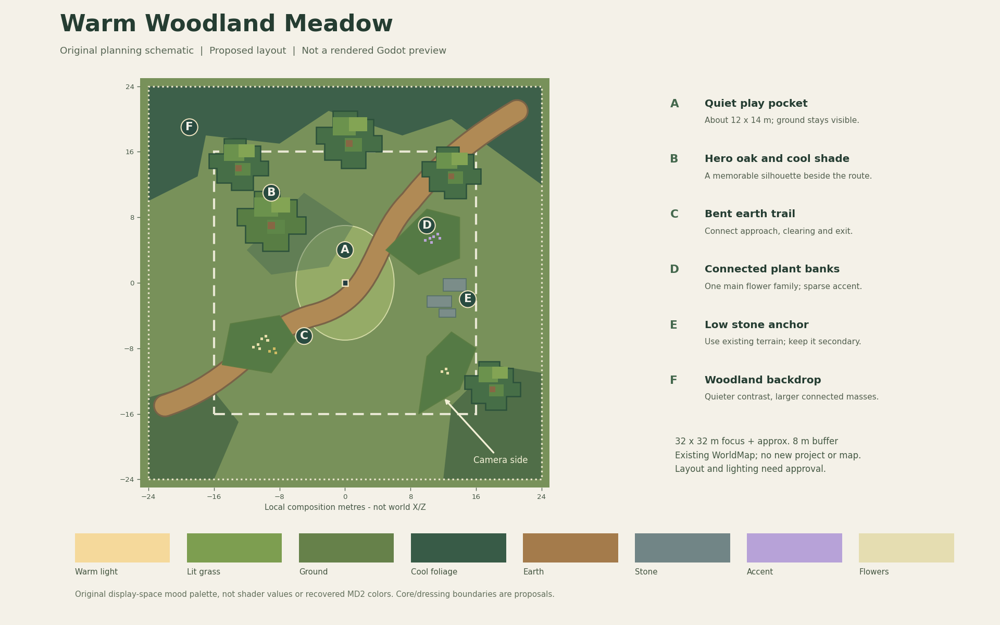

# Woodland meadow benchmark slice plan

Status: proposed build sequence, not an implementation authorization. Mood is
confirmed; layout and all numerical dimensions are designer recommendations.

## Scope and location

Create one **32 x 32 m authored focus area**, with an approximately 8 m dressing
buffer, inside the existing WorldMap. Keep a roughly **12 x 14 m quiet play
pocket** and a curved travel lane. Those are layout starting sizes, not native
MD2 measurements or immutable gameplay requirements.

The suggested site is the existing western grove near world X/Z **(-27.5, 8)**,
already used by Shift+G. Four current oak placements lie nearby. This is a
source-backed candidate, not a collision/framing-qualified site. M0 must confirm
it at the actual camera. A core around that centre spans approximately
X[-43.5,-11.5], Z[-8,24]; some buffer is outside the playable border but within
existing scenery. Keep the player route inside the existing boundary. If the
site cannot provide the quiet pocket without altering source terrain, choose
another existing patch and record it before blockout.

Use one current Day state and the existing orthographic gameplay camera. Preserve
all source cells, original assets, approved animations, controller, audio and
the rest of the map. This is a scene-local reversible dressing review, not a
new project, duplicated gameplay scene or edited `runtime.json`.

The schematic uses local composition coordinates, not world placements. Its
camera arrow is indicative; only the real gameplay camera validates the frame.

## The scene should contain

| Element | Purpose | First-pass constraint |
|---|---|---|
| Quiet clearing | Show player movement and give the eye a resting area | Visible ground, low planting; preserve room for future action readability |
| Hero oak | Give this location identity | Reuse an existing original oak; establish hierarchy through composition first |
| Supporting tree masses | Frame the clearing and establish depth | Start with about 3–5 visible oaks, not a new forest-wide density increase |
| Bent earth trail | Lead from approach through clearing toward shade | Irregular grass-soil transition, readable at gameplay distance |
| Two connected plant banks | Connect roots, ground and tree masses | Calm/transition/dense regions; controlled height and silhouette variation |
| Flower accents | Give the route a memorable color rhythm | One dominant family, one support, sparse contrasting pocket |
| Low stone/terrace edge | Anchor the scene without dominating it | Prefer existing terrain; no giant new stair wall or unrelated ruins |
| Restrained background | Make the clearing feel embedded in a world | Lower contrast/detail; no new biome, weather or water systems |

## Reversible authoring contract

Use a single scene-local review owner/profile when implementation is approved.
It owns only the selected zone's dressing and material overrides. It must save
and restore affected original instance transforms/visibility and materials.
Creating negative space may require a local per-instance selection of existing
plant batches; an add-only layer is not sufficient. Never delete source cells
or edit approved GLBs to achieve that selection. Preserve existing per-instance
wind/root channels and chunk culling.

The builder may choose the smallest existing-code integration for this owner;
likely touchpoints are `world_map.gd`, `world_map_grove.gd`,
`world_map_geometry.gd` and `world_map_look.gd`. A small
`world_map_gold_slice.gd` owner and versioned candidate profile are reasonable,
but not prerequisites for planning or permission to add a generic biome system.
Use one review selection in the current debug workflow; do not add another
project or a collection of permanent test scenes.

Changing layout also changes lighting inputs:

| Existing system | Required treatment when dressing changes |
|---|---|
| Global F11 sky/ground field | Keep profile/ownership behavior; tree movement alone does not require a shape-cache bake |
| Actor crown visibility | Re-register actual tree transforms with existing canonical shape caches; rebuild canonical caches only if meshes change |
| Canopy/root/contact fields | Refresh placement/height-dependent fields after layout freeze; no shadows left at old tree positions |
| Ground-reflected sunlight | Existing bake includes static source shadows/materials; disable stale application during blockout, then bake a separate candidate after layout is frozen |
| Experimental F12 terrain visibility | Keep off for the first reference baseline unless its final evidence gap is closed; added occluders or terrain changes require explicit reassessment |
| Direct moving tree shadows/reveal | Continue using actual current meshes/transforms and matching shadow deformation |

Record candidate placement, material, sun and source signatures. The source-map
hash alone does not detect every changed tree/material/shadow input. Preserve
all existing baseline caches; never bake a candidate over them. During blockout,
disable any stale spatial field instead of displaying incorrect contact light.

## Milestones and review gates

### M0 — Establish a trustworthy starting view

After direction approval, inspect the saved final-cache comparison failure.
This is targeted existing-Godot QA, not more MD2 reverse engineering. If F12
closure is still pending, explicitly keep it off in both baseline and candidate;
do not let that separate experiment block composition work. Confirm its disabled
path and original material restoration are sound.

Walk the proposed site, verify source terrain/support and camera reveal, then
freeze four view registrations: approach, clearing, under-oak and stone/path
junction. Record position, camera, look flags, resolution, renderer, AA, exposure,
grade, wind time and actor pose/time. Keep F7 off initially. Save baseline stills
and a normal-speed movement clip. Review eligibility/status of selected assets.

**Gate:** a reproducible baseline and a named site. No fresh extraction, shader
archaeology, camera redesign or source-asset changes.

### M1 — Compose the place with existing assets

Shape the clearing, trail bend, hero oak, supporting masses and a low stone
anchor. Use simple existing forms and current materials before adding small
detail. Apply reversible local planting selection to open the quiet pocket.
Preserve the original terrain/collision and permitted scale relationships.

**Gate:** at gameplay distance and thumbnail size, the player, route and hero
feature read in the intended order. Check approach from two directions and
foliage reveal. The user reviews composition before material/detail polish.

### M2 — Unify ground and material relationships

Connect earth wear, root soil and grass-bank edges. Tune candidate material
relationships in controlled original variants; preserve approved source texture
clusters and import-channel contracts. Keep roughness/specular restrained.
Do not use a new LUT to conceal unrelated material hues or hard planting seams.

**Gate:** normal-view and close-view ground joins agree; no square fade seams,
dark root rings, texture swimming or source-asset overwrites.

### M3 — Author vegetation rhythm and flower hierarchy

Refine two or three connected banks, with low/medium/tall silhouettes, small
internal gaps and sparse highlights. Concentrate flower families intentionally.
Change placement/spacing before adding meshes, shaders or species. Request new
original variants only if existing silhouettes cannot solve a specific gap.

**Gate:** richer edges and calmer play space coexist. No repeated-looking rows,
uniform bright tips, isolated tufts everywhere or tall foreground obstruction.

### M4 — Integrate light and atmosphere after layout freeze

Refresh only the affected original spatial-light registrations/bakes. Assess
sunlit clearing, tree shade and the stone junction with the established grade
and camera. Use geometry and local response to shape depth first. Tune final
palette/atmosphere only after material relationships work; change one group at
a time and save matched before/after images.

**Gate:** shaded player remains readable, contacts are grounded and indirect
light does not look like emission. Background depth improves without milky
foreground haze. No stale cache remains enabled.

### M5 — Validate the living scene

Reuse existing breeze, player passage, crown shadows and render interpolation.
Walk, sprint, turn, jump, stop under a tree and return to the trail. Check roots,
grass recovery, synchronized shadows, canopy reveal and temporal pixel clarity.
Preserve all approved character timing and poses.

**Gate:** a 10–15 second normal-speed comparison clip looks coherent and stable.
Offline frame exports do not count as performance measurements.

### M6 — Review, profile and publish the recipe

Apply [EVALUATION.md](EVALUATION.md). Run separate timing sessions without image
readback, then real-device/thermal checks when available. Device export requires
an original-only development dependency/eligibility audit; no export preset is
currently verified. Do not ship private research loaders or native assets.

Freeze the accepted profile, asset/placement manifest, four views and movement
route, comparison evidence, measured tier settings and restoration tests. A
user-approved desktop art candidate can guide discussion while device gates
remain pending; it is not a mobile-qualified benchmark or shipping-performance
claim. WorldMap currently has combat/spawn disabled: action/load qualification
must later use an approved representative workload before game-ready claims.

## Definition of the final deliverable

One inspectable region in the existing playable WorldMap; one reversible baseline;
an original asset/placement/material/light recipe; four controlled comparison
views; a normal-speed motion clip; completed art rubric; scoped technical checks;
and per-device measured performance results or explicit pending labels. Only
after approval should future maps reuse this recipe.
