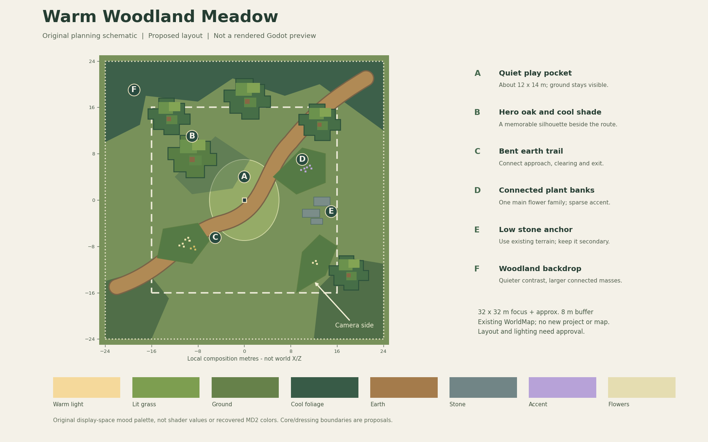

# GameAssetFactory visual direction package

Planning revision: 2026-11-08. Source checkpoint: `7e5a1702`.

**Confirmed mood:** a sunlit meadow at a woodland edge, with warm light, cool
shade and a sense of adventure. The user selected this mood. The detailed art
rules, layout, review thresholds and budgets below are proposals for approval.
No game code, scene, shader, asset, setting or graphics checkpoint was changed
to create this package. The old broad reverse-engineering goal remains paused.

The next deliverable is one deliberately composed, playable environment that
can guide later maps. MD2 supplies a quality benchmark; our own assets, visual
identity, gameplay readability and mobile performance determine the design.

Read in this order:

1. [Graphics direction](GRAPHICS_DIRECTION.md): lessons and seven visual pillars.
2. [Current gaps](CURRENT_GAPS.md): concrete observations and priorities.
3. [Slice plan](OVERWORLD_GOLD_SLICE_PLAN.md): site, composition and build gates.
4. [Evaluation](EVALUATION.md): art review, technical vetoes and promotion rules.
5. [Mobile constraints](MOBILE_BUDGET.md): supported path and proposed budgets.

The diagram is an original planning schematic, not a rendered preview or an
executable placement map. Its [SVG source](gold_slice_layout.svg) is editable.

## Handoff rules

- Keep the [closed graphics checkpoint](../../../GRAPHICS_HANDOFF.md) immutable.
  It describes implementation, evidence and unresolved issues, not an art brief.
- A **verified fact** comes from that checkpoint or current source; an
  **observation** comes from an identified archived frame; a **proposal** still
  needs review. None is a new gameplay/performance test.
- The owner approves artistic direction and final benchmark status. Integration,
  automated tests or this package do not promote Pending assets automatically.
- After plan approval, begin M0/M1 in the existing WorldMap. Do not build another
  project, expand the map, develop night/biomes or resume general GPU archaeology.
- Keep native MD2 captures, meshes, textures, shader code and derived reference
  arrays in private Research. This package contains original text and diagrams.

Implementation is **not started**. First decision after reading: approve or
revise the direction and the M0/M1 blockout scope. The final game-quality and
device-performance gates remain open.
